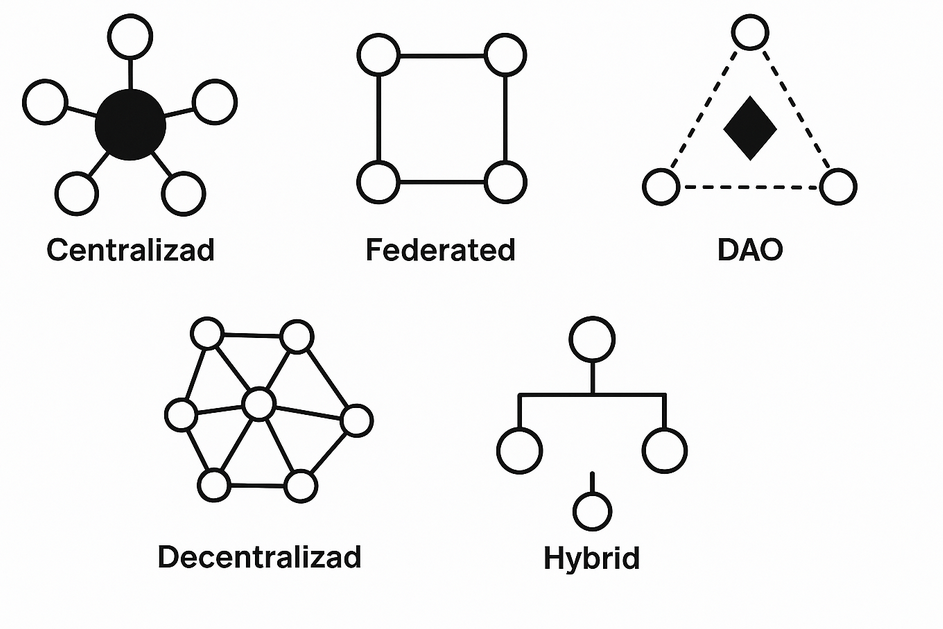
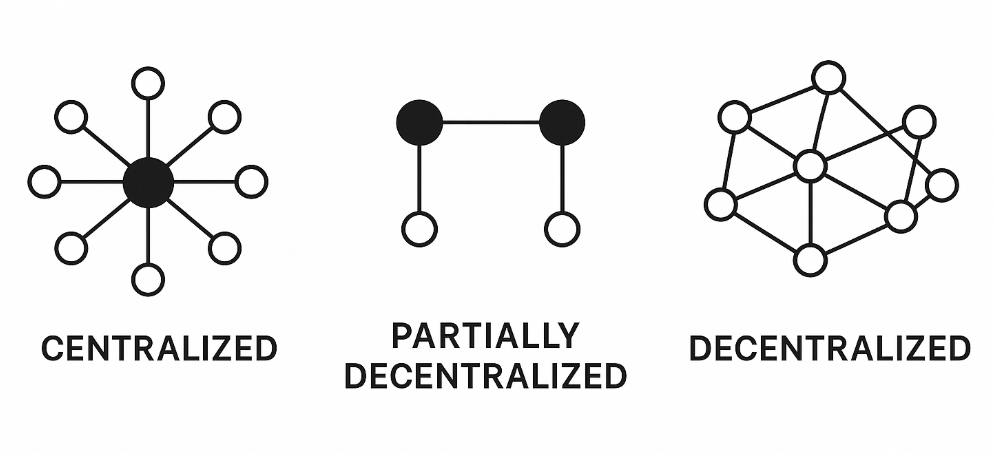
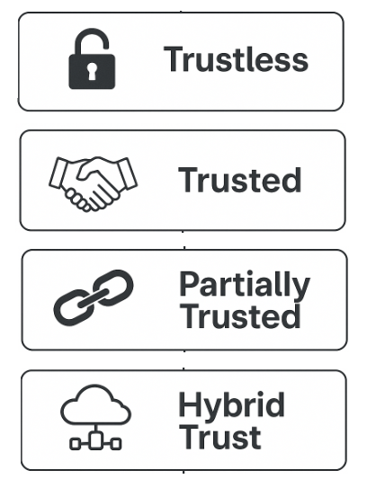
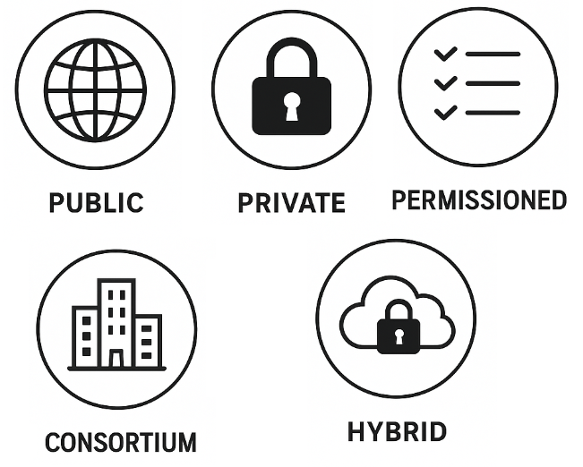
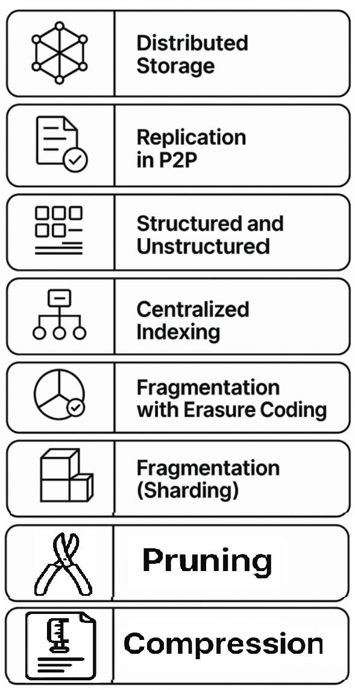

# Características de una red p2p

Existen propiedades o cualidades que definen una red p2p y que podemos enumerar.

> Asumiendo que muchos conceptos se conocen sobre todo por blockchain, también los podemos aplicar a redes p2p.

## Modelo de gobernanza

El modelo de gobernanza en una red p2p o sistema distribuido define cómo se toman las decisiones clave sobre la evolución del protocolo, la actualización de reglas y la resolución de conflictos. La gobernanza determina quién tiene autoridad para proponer, aprobar o rechazar cambios, y cómo se implementan estos cambios en la red. Dependiendo del propósito y del grado de descentralización (que veremos más adelante), existen diferentes enfoques de gobernanza, cada uno con sus ventajas y limitaciones.

Los principales modelos de gobernanza en sistemas distribuidos o blockchain principalmente son:

- Centralizada, una única entidad o grupo reducido controla las reglas, la validación y las actualizaciones del sistema. Este modelo permite una toma de decisiones rápida y un control claro, pero introduce un punto único de fallo y reduce la descentralización.
- Federada, varias entidades coordinadas —como redes, organizaciones o nodos seleccionados— comparten la responsabilidad de la gobernanza. Las decisiones se toman de forma conjunta, lo que mejora la resiliencia y la confianza, aunque requiere mecanismos de coordinación y consenso entre las partes. Un caso común de este modelo es el consorcio, donde un grupo de entidades colabora formalmente en la gestión y operación de la red.
- Descentralizada, todos los participantes de la red pueden influir en las decisiones, normalmente a través de mecanismos de consenso abiertos. Este modelo maximiza la participación y la resistencia a la censura, pero puede hacer más lento el proceso de toma de decisiones y requerir sistemas robustos para evitar ataques o manipulaciones.
- DAO (Organización Autónoma Descentralizada), la gobernanza se automatiza mediante contratos inteligentes y procesos de votación en la propia red (on-chain), donde los participantes suelen usar tokens para votar sobre propuestas. Este enfoque permite una gestión transparente y programable, eliminando intermediarios y facilitando la evolución del sistema según la voluntad colectiva.
- Híbrida, combina elementos de los modelos anteriores, por ejemplo, una DAO que delega ciertas decisiones a un comité multisig o a un grupo de expertos, o una red federada que incorpora mecanismos de votación abiertos para algunas cuestiones. Este modelo busca equilibrar eficiencia, seguridad y participación.

La elección del modelo de gobernanza influye directamente en la seguridad, la flexibilidad y la capacidad de adaptación de la red, y suele evolucionar con el tiempo a medida que la red crece y cambian sus necesidades.

**Mecanismos de decisión**:

Como aspecto en la gobernanza no debemos olvidar los mecanismos por los que se llega a un acuerdo, que igualmente afectan a los modelos de gobernanza en sistemas descentralizados. Estos mecanismos determinan cómo se valida una propuesta o se ejecuta una acción colectiva, definiendo el grado de participación y el umbral de consenso necesario. Entre los más comunes se encuentran:

- Mayoría simple: Una propuesta se aprueba cuando obtiene más del 50% de los votos válidos emitidos. Es el método más rápido, aunque puede favorecer decisiones poco consensuadas.  
- Mayoría absoluta: Requiere más del 50% de todos los votos posibles, incluyendo abstenciones o no participantes, lo que garantiza un apoyo más sólido.  
- Supermayoría: Exige un porcentaje mayor (por ejemplo, 66% o 75%) para aprobar decisiones críticas, como cambios en las reglas fundamentales o en el protocolo.  
- Delegación (democracia líquida): Los participantes pueden delegar sus votos en otros miembros de confianza, combinando participación directa y representativa.  
- Consenso total: Todas las partes deben estar de acuerdo antes de proceder. Aunque garantiza alineación completa, es el más lento y difícil de alcanzar en sistemas amplios.

## Grado de descentralización

Define cuánto control está distribuido entre los nodos de la red y si existen jerarquías, lo que influye en la escalabilidad y facilidad de diseño.

  > El [Coeficiente de Nakamoto](https://www.nervos.org/knowledge-base/what_is_nakamoto_coefficient_(explainCKBot)) es una métrica que cuantifica el grado de descentralización midiendo el número mínimo de entidades que necesitarían coludirse para controlar la red.

Puede ser normalmente:

- Centralizadas (Centralized), control total por una entidad, son redes cliente-servidor P2P con controlador central.
  
  > Se menciona a modo de divulgación, pero no es normal encontrarlo, aun menos en la web3.

- Parcialmente descentralizadas (Partially decentralized), varios nodos controlan la red, pero no todos. Ej: gobernanza de consorcios (como veremos en [modelo de autorización](#modelo-de-autorización)), federaciones (del [modelo de gobernanza](#modelo-de-gobernanza)); y soluciones como supernodos (como detallaremos en [clases de nodos](08-node-roles.md#clasificación-por-capacidad)) y uso de índice centralizado (como veremos en [estrategia de almacenamiento](#estrategias-de-almacenamiento-en-redes-p2p)).
- Totalmente descentralizadas (Fully decentralized), todos los nodos tienen el mismo rol, sin jerarquía. Ej: Bitcoin, IPFS (sin bootstrap central), [Gnutella](https://en.wikipedia.org/wiki/Gnutella).

Normalmente, un mayor grado de centralización suele buscar:

- Mejor rendimiento (menor latencia y mayor throughput).

  > [throughput](https://en.wikipedia.org/wiki/Network_throughput) es la cantidad de datos o transacciones procesadas por unidad de tiempo en una red. En redes blockchain, suele medirse en transacciones por segundo (TPS) o bloques por segundo. Cuanto mayor el throughput, mayor la capacidad de procesamiento de la red.

- Control más sencillo (gobernanza y actualizaciones).
- Seguridad operativa (menos superficie de ataque si los nodos son confiables).

  > Más seguridad operativa, pero menor descentralización y menor resiliencia al existir punto único de falla.

- Menor complejidad de consenso (menos nodos que coordinar).

## Modelo de confianza

Define cómo y en quién confían los nodos para interactuar, validar información y alcanzar consenso. Determina si la red requiere identidad, reputación o prueba criptográfica para garantizar seguridad y funcionamiento correcto.

Puede ser normalmente:

- Sin confianza ([Trustless](https://academy.binance.com/es/glossary/trustless)), donde los nodos interactúan sin necesidad de confiar entre sí, ya que utilizan [mecanismos criptográficos](https://es.wikipedia.org/wiki/Criptograf%C3%ADa) y [reglas de consenso](https://www.bitstamp.net/es/learn/security/what-are-blockchain-consensus-rules/) verificables. Estos mecanismos generan pruebas objetivas, como los árboles de Merkle (para verificar integridad de datos) o las zk-proofs (para demostrar la validez de información sin revelarla). Ejemplos claros son blockchain con Bitcoin, Ethereum, IPFS + FileCoin.
- Confiable o basado en confianza (Trusted), los nodos interactúan basándose en relaciones de confianza previa, donde existe identidad verificada o autoridad central parcial que ayuda a autenticar al nodo, reduciendo la necesidad de mecanismos criptográficos o consenso complejo. Por ejemplo, igualmente en blockchain en redes corporativas como [Hyperledger Fabric](https://en.wikipedia.org/wiki/Hyperledger#Hyperledger_Fabric) con [Proof of Authority](https://en.wikipedia.org/wiki/Proof_of_authority) (PoA).
- Parcialmente confiable (Partially trusted), combina nodos confiables con nodos anónimos o no verificados, aplicando confianza selectiva. Usa mecanismos criptográficos y validación, pero permite ciertos roles privilegiados o relaciones basadas en confianza. Por ejemplo, [Lightning Network](https://es.wikipedia.org/wiki/Lightning_Network) (sobre Bitcoin):
- Confianza híbrida (Hybrid trust), combina modelos trustless y trusted, donde algunas funciones dependen de nodos confiables o autoridades, y otras se descentralizan mediante consenso y criptografía. Ejemplo [Ripple](https://es.wikipedia.org/wiki/Ripple_Labs,_Inc.), donde usa un conjunto confiable de nodos validadores (UNL), pero con comunicación P2P.

  > La diferencia entre Partially trusted e Hybrid trust, en la primera se reconoce que en ciertos nodos se puede confiar más por su propia naturaleza, en la segunda combina explícitamente componentes o mecanismos centralizados, así que se puede decir que más que una diferencia es evolucionar de un grado de descentralización de mayor a menor.

## Modelo de autorización

Define quién puede participar y con qué permisos, lo cual influye en la resistencia a la censura, tolerancia a fallos y gobernanza.

Puede ser normalmente:

- Pública, cualquier participante puede unirse y participar sin restricciones, es abierta a nuevos participantes.
- Privada, acceso limitado a entidades previamente autorizadas, suele tener un control centralizado dentro de una organización o grupo.
- Consorcio, gobernada por un grupo seleccionado de entidades confiables, es un tipo de red privada, pero gestionada por un grupo de entidades (no sólo una).
- Permisionada, participación permitida a nodos verificados y aprobados; es una red privada o pública que se abre a más participantes bajo unas condiciones. Además define roles o permisos específicos, por ejemplo, unos nodos pueden leer solamente y otros escribir. Puede ser pública y permisionada, por ejemplo, participación validada pero lectura de los nodos abierta.
- Híbrida, mezcla características de modelos públicos y privados.

## Estrategias de almacenamiento en redes p2p

Definen cómo se organiza y guarda la información entre los nodos participantes. Buscan optimizar la disponibilidad, localización eficiente de datos y equilibrio de carga.

El Almacenamiento Distribuido (Distributed Storage), donde los datos se distribuyen entre múltiples nodos de la red utilizando [técnicas de replicación](07-replication-and-consistency.md#técnicas-de-replicación),—como la replicación parcial, total o bajo demanda del usuario—, es la estrategia principal aplicada en una red p2p.

Además, como veremos más adelante, la red puede ser [estructurada](03-topologies.md#topología-estructurada), [no estructurada](03-topologies.md#topología-no-estructurada) o una solución mixta. En las redes estructuradas, el almacenamiento y la búsqueda de datos se gestionan de forma determinista mediante índices distribuidos (como las DHT), lo que permite búsquedas rápidas y eficientes. En las no estructuradas, los datos se almacenan y localizan de manera más aleatoria, propagando consultas entre nodos; esto resulta menos eficiente, pero aporta mayor resiliencia frente a desconexiones. La elección de la topología de la red es, por tanto, una decisión clave que impacta directamente en la estrategia de almacenamiento.

Además, existen otras decisiones que pueden tomarse para optimizar el almacenamiento, aunque a veces impliquen reducir el grado de descentralización. Estas se aplican cuando las circunstancias específicas de la red lo requieren, por ejemplo:

- Indexación centralizada (Centralized indexing), un servidor central mantiene un índice de los archivos disponibles, pero los datos se transfieren directamente entre nodos. Ejemplo: [Napster](https://es.wikipedia.org/wiki/Napster) (modelo híbrido respecto a la descentralización).
- Fragmentación con [Erasure Coding](https://en.wikipedia.org/wiki/Erasure_code), los datos se dividen en fragmentos codificados matemáticamente, permitiendo recuperación incluso si se pierden algunos. Ejemplo: [Tahoe-LAFS](https://www.tahoe-lafs.org/trac/tahoe-lafs), [Filecoin](https://storj.dev/learn/concepts/file-redundancy#erasure-code) (opcional).

  > No se incluye como [técnicas de replicación](07-replication-and-consistency.md#técnicas-de-replicación) porque no copia íntegramente los datos, sino que los codifica en fragmentos con redundancia dispersa, aunque si no estás de acuerdo y lo pondrías, opina al respecto.

- Fragmentación ([Sharding](https://es.cointelegraph.com/explained/sharding-an-opportunity-for-distributed-scalability)): los datos o el estado de la red se dividen en fragmentos (shards), y cada fragmento es gestionado por un subconjunto de nodos, permitiendo procesar operaciones en paralelo y mejorar la escalabilidad. Ejemplos de sharding en redes P2P incluyen [Ethereum](https://www.bitstamp.net/es/learn/blockchain/what-is-sharding-on-ethereum/), [Polkadot](https://wiki.polkadot.network/docs/learn-parachains), [Near Protocol](https://academy.bit2me.com/que-es-near-protocol/), etc.

Otras técnicas complementarias para optimizar el almacenamiento incluyen:

- Pruning (podado), es una técnica que consiste en eliminar datos antiguos, irrelevantes o ya procesados con el objetivo de liberar espacio y optimizar el uso del almacenamiento. Los nodos que aplican pruning conservan únicamente el estado actual o los bloques más recientes, descartando el historial completo de transacciones. Un ejemplo común son los nodos podados en redes como Bitcoin o Ethereum, que mantienen solo las cabeceras y el estado global actual, reduciendo significativamente el consumo de disco. En contraste, los nodos históricos (archival nodes) almacenan toda la información completa desde el génesis.
- Compresión, donde se combina formatos binarios compactos, deduplicación por hash y, en algunos casos, compresores como gzip, para reducir el espacio sin afectar la estructura ni la eficiencia.
