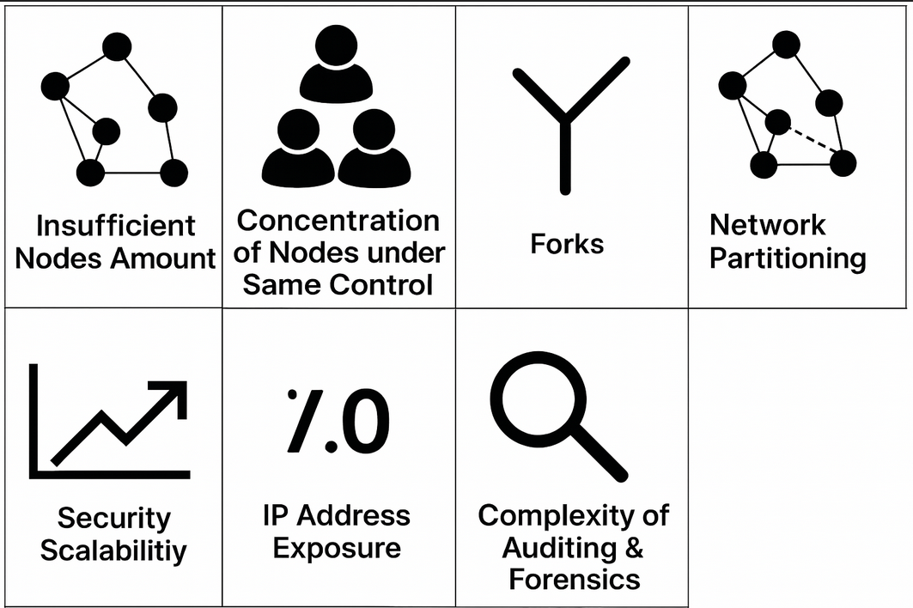
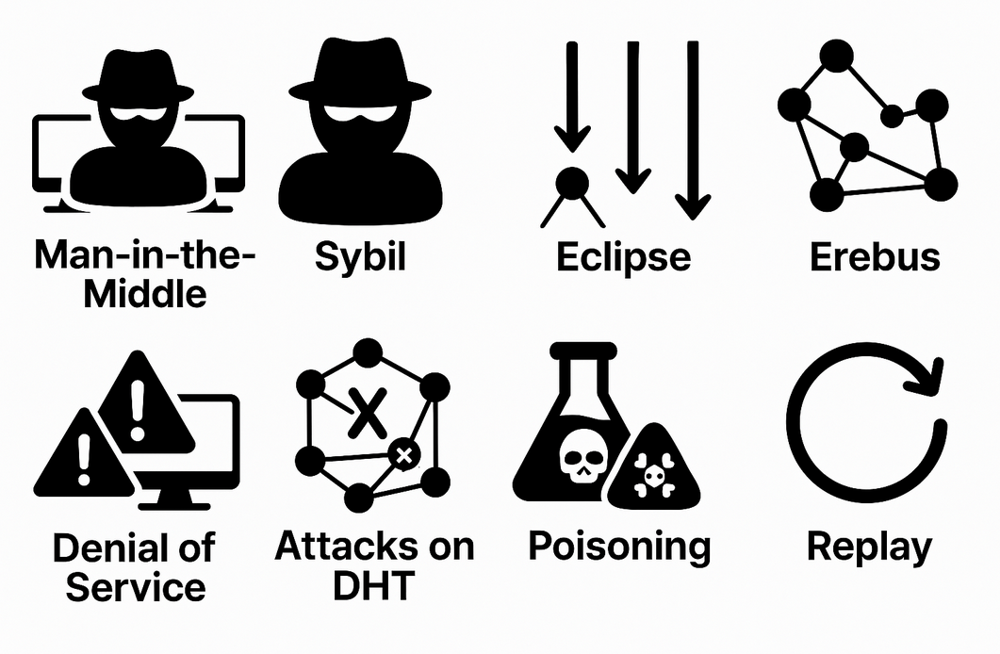
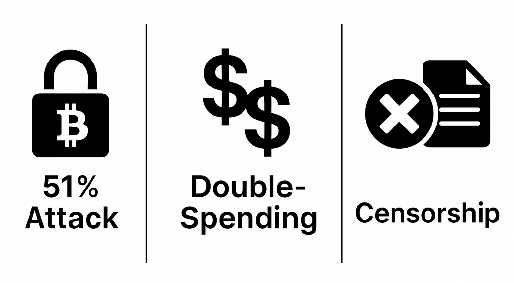
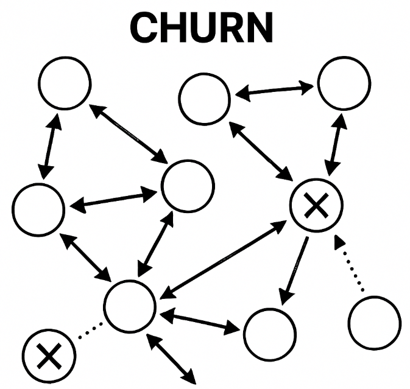
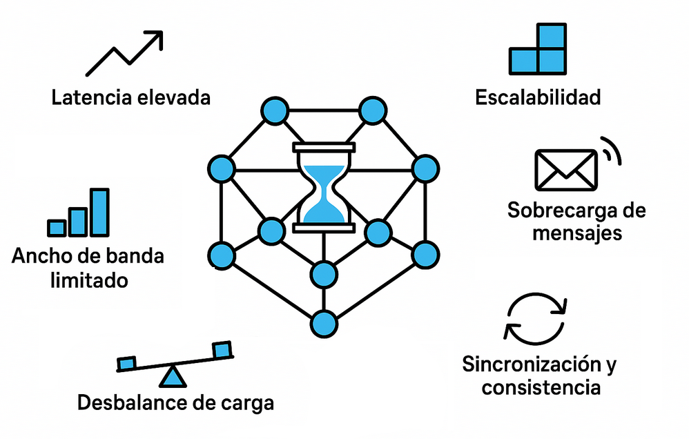

# Desafíos y Vulnerabilidades en Redes P2P

Las redes p2p vienen a resolver principalmente, el problema de la centralización y el punto único de fallo y para ello los nodos deben comunicarse entre iguales siguiendo el protocolo, pero esto también tiene ciertos desafíos que se deben considerar y que podemos resumir como:

## Problemas en redes p2p

Estos problemas pueden ser inherentes al diseño descentralizado de las redes P2P y pueden surgir sin intervención maliciosas:

- Insuficiente cantidad de nodos: Cuando la red P2P cuenta con pocos nodos activos, se reduce la redundancia y la disponibilidad de los recursos compartidos. Esto puede provocar que ciertos archivos o servicios sean inaccesibles si los pocos nodos que los alojan se desconectan. Además, una baja cantidad de nodos limita la resiliencia ante fallos y ataques, y dificulta el escalado eficiente de la red.
- Concentración de nodos bajo un mismo control: Si un número significativo de nodos es operado o controlado por los mismos actores, se debilita la descentralización y se incrementa el riesgo de manipulación, censura o recopilación masiva de datos. Esta concentración puede facilitar ataques coordinados (como Sybil o Eclipse), reducir la diversidad de la red y comprometer la confianza en el sistema.
- Fragmentación de la red (network partitioning): Ocurre cuando los nodos se dividen en subgrupos aislados debido a fallos físicos de conectividad, como cortes de red o fallos de infraestructura. Esto impide una visión global coherente y afecta la sincronización. Por ejemplo, en una red P2P como IPFS, una fragmentación puede dificultar el acceso a ciertos contenidos si los nodos que los alojan están desconectados.
- Estado paralelo ([forks](https://es.wikipedia.org/wiki/Bifurcaci%C3%B3n_(blockchain))): Diferentes grupos de nodos pueden tener visiones contradictorias del estado de la red debido a desacuerdos en el consenso. Aunque los mecanismos de consenso suelen resolver estos forks, la divergencia temporal puede causar problemas, especialmente en blockchains como Ethereum, donde un fork puede permitir ataques como el doble gasto si no se resuelve rápidamente.
- Escalabilidad de la Seguridad (Dificultad de Aplicación de Políticas Uniformes): A medida que la red crece, la aplicación de medidas de seguridad uniformes en todos los nodos se vuelve extremadamente compleja. No hay un punto central para distribuir actualizaciones de seguridad o parches, y cada usuario es responsable de su propia configuración en el nodo, lo que lleva a un ecosistema heterogéneo.
- Exposición de Direcciones IP (en algunos modelos P2P): En muchos diseños P2P, los nodos necesitan conocer las direcciones IP de otros nodos para establecer conexiones directas. Esto expone las direcciones IP de los usuarios, lo que puede ser utilizado para ataques dirigidos, monitoreo de actividad o deanonymization si no se toman precauciones adicionales (como el uso de proxies o TOR).
- Complejidad de la Auditoría y Forense: En caso de un incidente de seguridad, la naturaleza distribuida de las redes P2P hace que sea extremadamente difícil realizar una auditoría completa o un análisis forense. No hay registros centralizados, y rastrear el origen de un problema a través de una multitud de nodos efímeros es una tarea monumental.

## Desafíos derivados de la resistencia a la censura

Si bien la resistencia a la censura es una de las principales virtudes de las redes P2P, esta característica también conlleva efectos secundarios que pueden ser vistos como problemáticos. Más que problemas en sí mismos, son consecuencias inherentes de la descentralización y la falta de control centralizado. Los detractores suelen señalar estos aspectos como contraparte de la libertad que ofrecen las redes P2P:

- Falta de filtro de contenido: Al no haber un servidor central que actúe como filtro, el contenido distribuido en una red P2P es en gran medida incontrolado. Esto facilita la proliferación de contenido ilegal, malware o spam, y es un desafío para la moderación.
- Anonimato y pseudonimato: La naturaleza descentralizada de muchas redes P2P dificulta la identificación real de los usuarios. Si bien esto puede ser una ventaja para la privacidad, también facilita actividades ilícitas y hace más difícil responsabilizar a los actores malintencionados. No hay una autoridad central que verifique identidades.
- Dificultad para aplicar regulaciones: La ausencia de un punto central de control complica la aplicación de normativas legales o regulatorias, lo que puede generar conflictos con legislaciones locales o internacionales.
- Persistencia de contenido no deseado: Una vez que un archivo o información se distribuye en una red P2P, puede ser extremadamente difícil eliminarlo por completo, ya que puede estar replicado en múltiples nodos fuera del alcance de cualquier autoridad.
- Coordinación limitada para la moderación: La descentralización dificulta la organización de esfuerzos coordinados para moderar o eliminar contenido dañino, lo que puede llevar a respuestas lentas o ineficaces ante incidentes.

## Ataques a la seguridad

Además de los problemas, las redes P2P son vulnerables a ataques intencionales que explotan su diseño descentralizado. Estos incluyen:

- Man-in-the-Middle ([MITM](https://es.wikipedia.org/wiki/Ataque_de_intermediario)): Un atacante intercepta y potencialmente altera la comunicación entre dos nodos sin que estos lo detecten. Por ejemplo, en una red P2P de mensajería como Tox, un MITM podría modificar mensajes para engañar a los usuarios.
- [Sybil](https://academy.bit2me.com/que-es-un-ataque-sybil/): Un atacante crea múltiples identidades falsas para influir en la red, manipular el consenso o recopilar información. Este ataque es común en redes de intercambio de archivos como BitTorrent, donde nodos falsos pueden sabotear la distribución de contenido.
- [Eclipse](https://academy.bit2me.com/que-es-ataque-eclipse-eclipse-attack/): Un nodo es rodeado por nodos maliciosos dentro de la red P2P, controlando toda su información entrante y saliente. En Ethereum, por ejemplo, un ataque Eclipse podría aislar a un nodo para evitar que valide transacciones legítimas.
- [Erebus](https://es.cointelegraph.com/explained/erebus-attack-explaining-its-scope): Similar a Eclipse, pero opera a nivel de infraestructura, manipulando rutas antes de que el tráfico llegue a la capa P2P. Esto aísla al nodo víctima y controla su percepción de la red.
- Denial of Service ([DoS](https://academy.bit2me.com/que-son-ataques-dos/)): Ataques que saturan nodos o la red con tráfico basura para interrumpir el servicio. Por ejemplo, un DoS podría colapsar nodos clave en una red de streaming P2P como PeerTube.
- [Ataques a la DHT](https://medium.com/unitychain/dht-attacks-and-defenses-e159b3d1bcf8): Manipulación o envenenamiento de tablas hash distribuidas para redirigir tráfico, censurar información o dificultar la búsqueda de recursos. En BitTorrent, un ataque a la DHT podría redirigir a los usuarios a contenido malicioso.
- Envenenamiento (Poisoning): Introducción de datos falsos o corruptos para corromper la información compartida. Por ejemplo, en una red P2P de intercambio de archivos, un atacante podría distribuir archivos falsos con malware.

### Ataques específicos a la lógica on-chain

Son ataques específicos a la lógica en redes P2P que son de blockchain y realizan alguna lógica on-chain, como ejecutar un script o un smart contract.

> Esto es un resumen, evidentemente hay más casos específicos que se verán en detalle mientras evolucione este repositorio de documentación.

- Ataque del 51%: Un grupo controla más del 50% del poder de cómputo o participación, permitiendo revertir transacciones, reescribir bloques o censurar la red. Este ataque afectó redes como Bitcoin Gold en 2018.
- Doble gasto (Double-spending): Intento de gastar el mismo activo digital más de una vez, aprovechando forks, latencias en la propagación de bloques o retrasos en el consenso. Común en blockchains sin suficiente descentralización o seguridad económica.
- Censura: Nodos o validadores bloquean selectivamente transacciones o bloques, afectando la neutralidad y disponibilidad de la red. Puede ser total (bloqueo directo) o parcial (priorización selectiva).

Si queremos ser específicos en ataques particulares:

- [Replay](https://academy.bit2me.com/que-es-un-ataque-replay/): Un ataque replay es un tipo de ataque genérico en los sistemas de información. En el contexto de redes blockchain, normalmente ocurre cuando un atacante intercepta y retransmite datos válidos previamente enviados —como credenciales de conexión en redes P2P para suplantar un nodo, transacciones durante un hard fork de blockchain para duplicar transferencias en ambas cadenas, o firmas en smart contracts para re-ejecutar funciones sin consentimiento— con el fin de engañar al sistema y lograr una acción o acceso no autorizado.
- Reentrancy: Un contrato externo llama de nuevo al contrato original antes de que este termine su ejecución y actualice su estado interno, permitiendo retirar fondos o ejecutar funciones múltiples veces de forma indebida. Se mitiga siguiendo el patrón *checks-effects-interactions* y usando `ReentrancyGuard`.
- RO-reentrancy (Read-Only Reentrancy)
- Integer overflow/underflow: Ocurre cuando una operación aritmética excede el rango máximo o mínimo permitido por el tipo de dato (por ejemplo, `uint256`), provocando valores incorrectos que pueden alterar saldos o lógicas críticas. Desde Solidity 0.8.x estos errores lanzan excepciones automáticas, pero siguen siendo relevantes en contratos antiguos.
- tx.origin attack: Vulnerabilidad lógica que aparece cuando un contrato usa `tx.origin` para autenticar al remitente. Un atacante puede hacer que un usuario ejecute una transacción a través de un contrato malicioso, y este a su vez llame al contrato vulnerable, haciendo que `tx.origin` siga siendo la dirección del usuario. Se evita utilizando `msg.sender` para validaciones de permisos.
- DoS a la lógica: Ataques de denegación de servicio en los que un actor provoca fallos intencionados o bloquea recursos del contrato (por ejemplo, consumiendo gas excesivo, enviando valores no esperados o controlando bucles que nunca se completan), impidiendo la ejecución normal de las funciones.
- DoS deadlock: Situación en la que un contrato queda bloqueado permanentemente debido a dependencias circulares, condiciones imposibles de cumplir o fallos en contratos externos que impiden completar transacciones críticas. Puede ocurrir cuando un contrato delega funciones a otro que falla o revierte sistemáticamente.
- Front-running / MEV (Miner Extractable Value): Un actor observa transacciones pendientes en el mempool y ejecuta otra antes o después para beneficiarse del orden de ejecución. Es común en exchanges descentralizados.
- Sandwich attack: Tipo específico de ataque MEV donde un atacante detecta una transacción pendiente de swap en un DEX y coloca dos transacciones propias: una justo antes (comprando el token) y otra justo después (vendiéndolo), aprovechando el deslizamiento de precio causado por la transacción de la víctima para obtener ganancias. El atacante paga gas fees elevadas para asegurar el orden de ejecución.
- Timestamp manipulation: Mineros o validadores alteran ligeramente las marcas de tiempo de los bloques para obtener ventajas en contratos dependientes del tiempo (por ejemplo, loterías o subastas).
- Warp Time Attack (Ataque de Manipulación Temporal): Ataque específico de blockchains PoS donde los atacantes manipulan los relojes del sistema para crear bloques con timestamps incorrectos, afectando el consenso de la red. Al controlar un número significativo de validadores y manipular sus timestamps, pueden acelerar el tiempo de la blockchain, permitiendo adelantar épocas, modificar la selección de validadores o explotar mecanismos dependientes del tiempo. Este ataque es particularmente relevante en protocolos que confían en timestamps de bloques para funciones críticas de consenso.
- Short address attack: Manipulación de la longitud de datos en una transacción para alterar cómo se interpretan los parámetros del contrato. Actualmente mitigado por los clientes modernos de Ethereum.
- WalletMultiSig: Vulnerabilidad en contratos multifirma donde un atacante puede explotar fallos en la lógica de validación de firmas para ejecutar transacciones sin el número requerido de aprobaciones, o manipular la lista de firmantes autorizados.
- Ice-Phishing: Técnica donde un atacante engaña al usuario para que firme una transacción de aprobación (`approve`) legítima que otorga permisos al atacante para gastar tokens del usuario. A diferencia del phishing tradicional, no requiere revelar claves privadas, solo firmar una transacción aparentemente inofensiva.

> Esta explicación no pretende hacer que seas un experto en seguridad, solo dar una dimensión de la complejidad y desafío de la seguridad on-chain.

### Otros ataques habituales en los que se ven afectadas redes P2P

- Phishing: Técnica de ingeniería social donde un atacante se hace pasar por una entidad confiable para engañar a los usuarios y obtener información sensible como claves privadas, credenciales o datos personales. En redes P2P, puede manifestarse mediante nodos falsos que simulan ser servicios legítimos, enlaces maliciosos distribuidos a través de la red, o mensajes engañosos que solicitan información confidencial. El impacto puede incluir robo de fondos, pérdida de acceso a cuentas o compromiso de la privacidad del usuario.
- Identity (ataques de identidad/suplantación): Un atacante se hace pasar por otro nodo o usuario legítimo de la red para obtener acceso no autorizado, manipular transacciones o difundir información falsa. En redes P2P, esto puede lograrse mediante el robo de claves privadas, la interceptación de comunicaciones o la explotación de vulnerabilidades en los mecanismos de autenticación. Este tipo de ataque puede comprometer la confianza en la red, permitir transacciones fraudulentas o facilitar otros ataques como el Eclipse o Man-in-the-Middle.

## Problema de disponibilidad o rotación: Churn

Churn (o "rotación de nodos") se refiere al fenómeno en el que los nodos de una red P2P se unen, abandonan o fallan con frecuencia, afectando la estabilidad y el rendimiento de la red.

> Quizás es un problema de seguridad, pero lo menciono como categoría nueva.

Causas del Churn:

- Nodos dinámicos: Usuarios que apagan sus dispositivos (ej. laptops, móviles) o cierran aplicaciones P2P.
- Fallos aleatorios: Conexiones inestables, cortes de energía o crashes de software.
- Comportamiento egoísta: Nodos que abandonan la red después de descargar un archivo (problema común en *file-sharing*).
- Ataques: Nodos maliciosos que entran y salen para sabotear la red (ej. ataques Sybil).

## Problemas de rendimiento

Los problemas de rendimiento en redes p2p surgen principalmente por la naturaleza descentralizada y la variabilidad de los nodos participantes. Los más comunes incluyen:

- Latencia elevada, la comunicación entre nodos puede requerir múltiples saltos, aumentando el tiempo de respuesta, especialmente en redes globales o con topologías no estructuradas (que veremos más adelante).
  - **Métrica típica**: Bitcoin ~10 segundos para propagación global de un bloque, Ethereum ~500ms.
- Ancho de banda limitado, los nodos pueden tener conexiones lentas o asimétricas, lo que afecta la velocidad de propagación de datos y la eficiencia general de la red.
  - **Requisitos típicos**: Bitcoin full node ~500GB almacenamiento + ~200GB/mes ancho de banda, Ethereum ~1TB + ~1TB/mes.
- Sobrecarga de mensajes, protocolos de difusión como flooding o gossip (que veremos más adelante) pueden generar un gran volumen de mensajes redundantes, saturando la red y los recursos de los nodos.
  - **Trade-off**: Mayor redundancia (más mensajes) = mayor fiabilidad pero menor eficiencia.
- Desbalance de carga, algunos nodos pueden recibir más solicitudes o almacenar más datos que otros, provocando cuellos de botella y afectando la disponibilidad.
- Escalabilidad, a medida que la red crece, mantener la eficiencia en la búsqueda, el [enrutamiento](05-routing-and-diffusion.md#enrutamiento-routing-en-redes-estructuradas) y la replicación de datos se vuelve más complejo.
  - **Throughput**: Bitcoin ~7 TPS, Ethereum ~15-30 TPS, Solana ~2,000-3,000 TPS (con mayor centralización).
- Sincronización y consistencia, mantener datos consistentes entre nodos distribuidos puede requerir mecanismos costosos en términos de comunicación y procesamiento.

**Métricas de rendimiento en redes P2P:**

- **Latencia de propagación**: Tiempo que tarda un mensaje en alcanzar todos los nodos.
- **Throughput (rendimiento)**: Número de transacciones o mensajes procesados por segundo (TPS).
- **Overhead de red**: Porcentaje de ancho de banda dedicado a mensajes de protocolo vs datos útiles.
- **Tiempo de sincronización**: Tiempo que tarda un nuevo nodo en sincronizar el estado completo de la red.

> Muchos de estos problemas son solventados, como los de seguridad, aplicando soluciones menos descentralizadas. Es decir, el trilema siempre se aplica cotejando descentralización con seguridad y escalabilidad.
