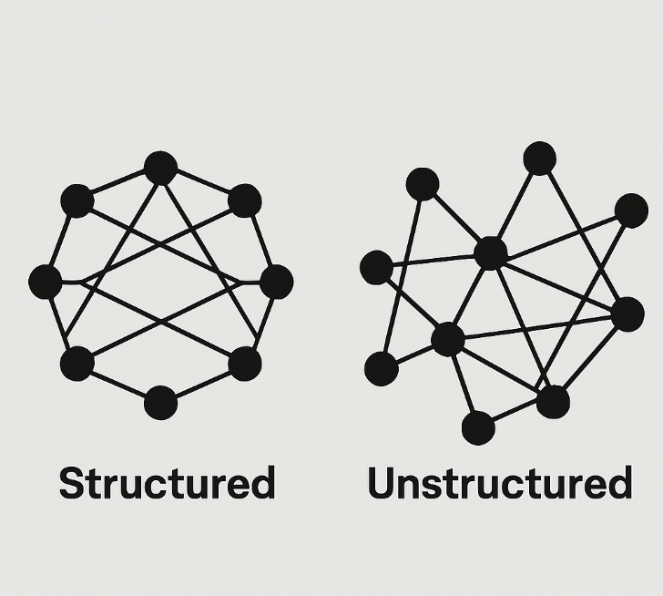
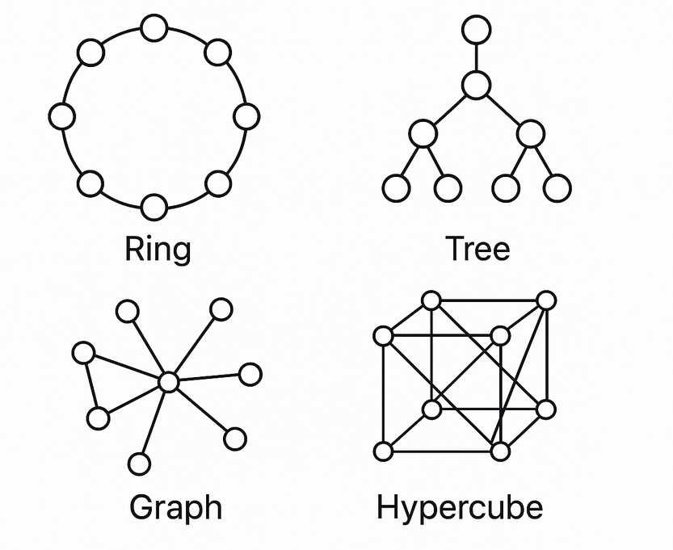
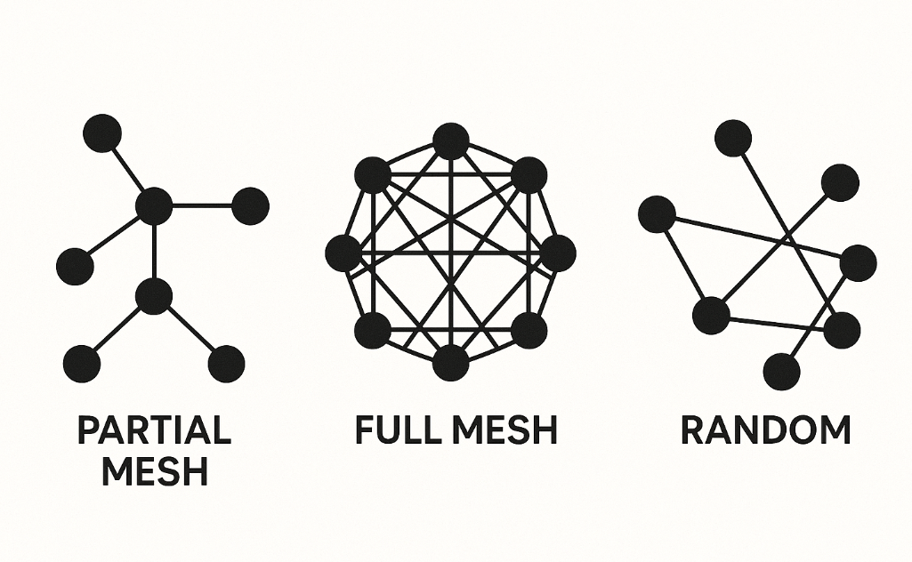

# Clasificación principal de redes p2p

Las redes p2p se organizan para buscar y compartir información siguiendo dos topologías lógicas conocidas —o, si se prefiere, siguiendo un modelo de [red superpuesta](https://es.wikipedia.org/wiki/Red_superpuesta) (overlay network): estructuradas y no estructuradas.

> Elegir entre estructurada o no estructurada, entre otros factores que veremos, principalmente depende de las [características iniciales](01-characteristics.md) y los [problemas que pueden surgir](02-challenges-and-vulnerabilities.md#problemas-en-redes-p2p), por ejemplo, si será una red pública o trustless o si se debe seguir una estrategia de almacenamiento, que permita la disponibilidad rápida y eficiente del contenido.

## Topología estructurada

En la topología estructurada se sigue un patrón definido y determinista, lo que permite búsquedas eficientes y uso optimizado del almacenamiento, siendo adecuado para redes estables (bajo churn), donde los nodos permanecen disponibles con regularidad.

En este tipo de redes, existe un mecanismo donde cada nodo (o su conjunto por redundancia) es responsable de almacenar un dato dado. Para ello, se emplean mecanismos de localización, que funcionan como índices distribuidos, los cuales asocian identificadores únicos (por ejemplo, hashes) con la ubicación lógica de los nodos encargados de gestionar el dato dentro de la red.

Para entender mejor estas redes, varemos la solución principal (y casi única en la práctica) de la [DHT](https://es.wikipedia.org/wiki/Tabla_de_hash_distribuida), que es un diccionario tipo clave/valor, con su implementación de [Kademlia](https://es.wikipedia.org/wiki/Kademlia), donde los nodos se organizan según la "distancia" XOR de sus identificadores y el hash del dato.

> 🤔 Entiendo que no hayas comprendido nada...esta explicación la veremos más en detalle en [los mecanismos de las redes p2p](04-bootstrap-and-node-discovery.md).

Existen otras implementaciones de DHT además de Kademlia, cada una con una topología lógica diferente que influye en cómo se enrutan y localizan los datos:

- Anillo: como en [Chord](https://es.wikipedia.org/wiki/Chord), que utiliza [Consistent Hashing](https://en.wikipedia.org/wiki/Consistent_hashing) y conecta los nodos en una estructura circular. Cada nodo es responsable de un rango de claves y el enrutamiento se realiza siguiendo el orden del anillo, logrando búsquedas eficientes y balanceo de carga.
- Árbol: aunque menos común en la práctica, existen propuestas como BATON (Balanced Tree Overlay Network), que implementan DHTs sobre árboles balanceados para optimizar búsquedas y balanceo de carga. En este modelo, los nodos se organizan jerárquicamente, donde los nodos padres coordinan a sus hijos, útil en escenarios de difusión o agregación.
- Grafo: algunas DHTs, como [Pastry](https://es.wikipedia.org/wiki/Pastry_(P2P)) y [Tapestry](https://es.wikipedia.org/wiki/Tapestry_(P2P)), emplean rutas prefijadas. Su topología combina características de árbol (por los niveles de prefijo en las rutas) y de grafo (por la redundancia y la existencia de múltiples caminos posibles entre nodos), lo que proporciona tolerancia a fallos y rutas alternativas.
- Hiperespacio (Hypercube): existen implementaciones como HyperCup y CubeNet, donde cada nodo representa un vértice de un hipercubo n-dimensional y se conecta a otros nodos que difieren en un solo bit en su identificador. Esta topología permite rutas logarítmicas y alta escalabilidad.

Y Kademlia - *¿qué topología es?*... Kademlia se considera una red que utiliza una métrica de distancia XOR para organizar y localizar nodos, en lugar de seguir una topología rígida como anillo, árbol o hipercubo. Por eso, habitualmente se clasifica aparte y no se menciona que sea una topología concreta.

> 🎓 Muchas de estas topologías han sido exploradas principalmente en el ámbito académico o en sistemas distribuidos tradicionales. En el contexto de la web3, donde priman la descentralización, la tolerancia a fallos y el direccionamiento por contenido, las DHT basadas en espacio de claves (como Kademlia) y en anillo (como Chord) resultan más adecuadas y son las más utilizadas en la práctica.

## Topología no estructurada

En las topologías no estructuradas, las conexiones entre nodos son aleatorias o sin un patrón definido, lo que las hace más adecuadas para consultas complejas y además es más óptimo para entornos inestables donde los nodos se conectan y desconectan con frecuencia (alto churn). Son redes más resilientes, pero al no existir una estructura lógica que relacione directamente el contenido con nodos específicos, las consultas deben propagarse entre múltiples nodos para localizar la información, aunque lo cierto es que permite consultas más complejas que las estructuradas.

En la topología no estructurada se utilizan técnicas de propagación (que forma parte de las [técnicas de difusión](05-routing-and-diffusion.md#técnicas-de-difusión-en-redes-no-estructurabas)) como [Flooding](https://en.wikipedia.org/wiki/Query_flooding) (malla completa), [Scoped Flooding](https://suzanbayhan.github.io/pdf/2018_wang_understanding_scoped_flooding.pdf) (malla completa) y [Random Walks](https://en.wikipedia.org/wiki/Random_walk) (random). En Web3 predomina [Gossip](https://academy.bit2me.com/que-es-gossip-protocol/) y derivados como [Gossipsub](https://github.com/libp2p/specs/tree/master/pubsub/gossipsub) y [Gossip Epidemic](https://viktoria-karamyshau.medium.com/gossip-epidemic-protocols-b1d44ce50c10) (las tres como malla parcial).

Las topologías mencionadas como malla parcial, malla completa o topología aleatoria se puede representar como:

> 🎓 Este es solo un resumen orientativo; el objetivo es ofrecer una visión general, no una explicación exhaustiva, es posible que existan fallos o generalizaciones sobre las topologías ahora explicadas, pero es un tema tan complejo y no es objetivo de este documento profundizar mucho más.

## Aclaraciones de topología redes

**¿Cuándo se usa una red no estructurada o estructurada?**

Depende principalmente del propósito de la red, definido inicialmente al establecer sus características. Por ejemplo, una red pública, con alto grado de descentralización y posiblemente alto churn, que requiera resiliencia y tiene que ser más simple, será no estructurada; mientras que una red más estable, escalable y con bajo churn, donde la eficiencia sea clave, optará por una topología estructurada, pero exigirá un diseño más complejo que permita consultas simples y directas.

**¿Existen soluciones mixtas de redes p2p no estructuradas y estructuradas?**

Sí, como veremos, una red p2p puede usar parte del protocolo de red estructurada, por ejemplo para el descubrimiento de nodos, y para el resto de casos ser realmente una red no estructurada.
Es decir, cada red implementa lo que mejor sirva para su propósito, y en general, no tiene que existir una doctrina fijada.

> 📌 Este resumen de redes p2p intenta generalizar y clasificar, pero no tenemos que olvidar que cada red tiene sus peculiaridades.
