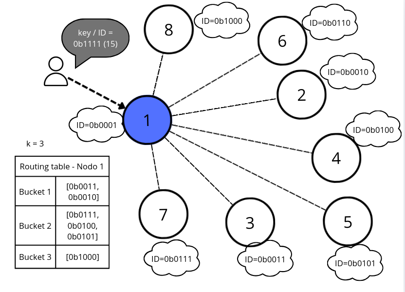
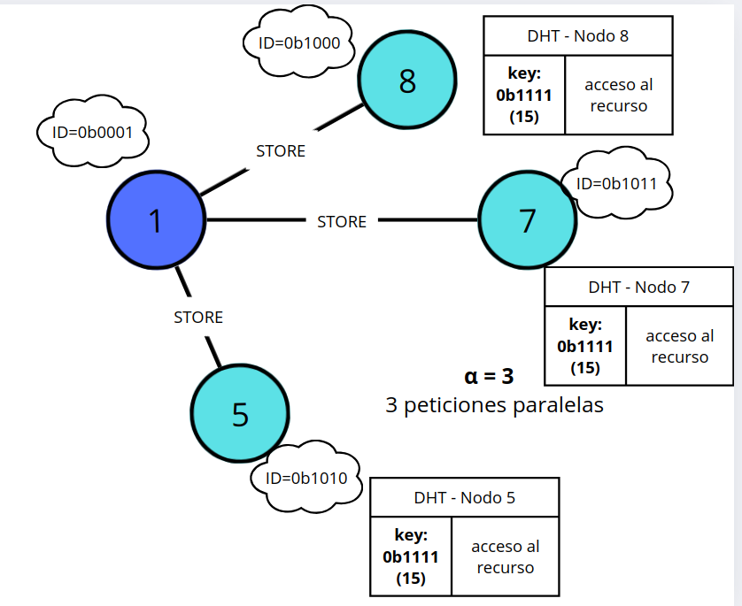
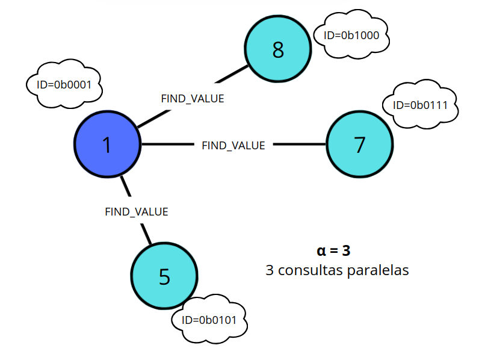
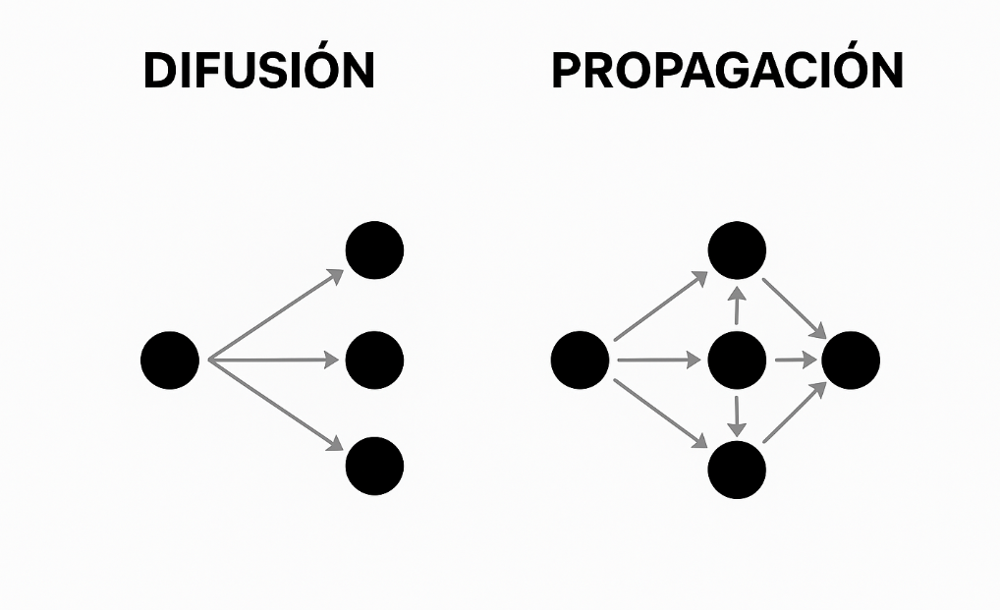

# Mecanismos de las redes p2p: enrutamiento, difusión y propagación

## Enrutamiento (Routing) en redes estructuradas

Es un proceso propio de las redes P2P estructuradas y consiste en determinar qué conjunto de nodos son responsables de gestionar una operación, lo que sería comúnmente atender una solicitud de escritura (W) o lectura (R).

El enrutamiento ocurre por lo tanto en cualquier momento que sea necesario, según sea solicitado.

Como vimos en el descubrimiento de nodos, el enrutamiento también busca ser determinista y siguiendo el ejemplo de la DHT Kademlia, se basa en la cercanía XOR entre el ID de un nodo y la key o hash del dato.

> Aunque diferentes nodos inicien una operación, el uso del XOR con la key del dato hace que converjan hacia los mismos nodos cercanos responsables del dato. Es decir, con esto es posible que los nodos responsables sean siempre un conjunto determinado.

Es complicado entenderlo, así que lo veremos en un ejemplo:

**En el caso de escribir (W)**.

*Contexto inicial*:



- Inicialmente existe una transacción iniciada desde el propio nodo, siendo el que podríamos denominar el nodo propietario.
- En este ejemplo no veremos cada paso de la transacción (depende de cada red p2p), nos centraremos como en base a un identificador o key que hace referencia al recurso (normalmente su hash), se realiza una solicitud para guardar en la DHT. Este recurso puede representar datos como archivos, fragmentos de archivos, metadatos, bloques de datos en una blockchain, o cualquier otro recurso específico que la red P2P esté diseñada para gestionar.
- El nodo 1, que recibe la petición, tiene inicialmente agrupados en buckets los diferentes nodos que conoce, siendo los nodos con:
  - En bucket 0: no tiene.
  - En bucket 1: ID 3 (0b0011), ID 2 (0b0010).
  - En bucket 2: ID 7 (0b0111), ID 4 (0b0100), ID 5 (0b0101).
  - En bucket 3: ID 8 (0b1000).

*Calcular cercanía según objetivo (simplificado)*:

Como comentamos se hacen a un conjunto de nodos los responsables del dato y esto se basa en la "cercanía", por lo tanto, en base al key objetivo `0b1111` (15) si lo expresamos de una forma simplificada, consiste en calcular la cercanía de ese key con todos los ID de nodos en la routing table, es decir, la operación sería:

```plaintest
0b0011 XOR 0b1111 = 0b1100 (12)
0b0010 XOR 0b1111 = 0b1101 (13)
0b0111 XOR 0b1111 = 0b1000 (8)
0b0100 XOR 0b1111 = 0b1011 (11)
0b0101 XOR 0b1111 = 0b1010 (10)
0b1000 XOR 0b1111 = 0b0111 (7)
```

Y claro está ordenados sería:

```plaintest
0b1000 XOR 0b1111 = 0b0111 (7)
0b0111 XOR 0b1111 = 0b1000 (8)
0b0101 XOR 0b1111 = 0b1010 (10)
0b0100 XOR 0b1111 = 0b1011 (11)
0b0011 XOR 0b1111 = 0b1100 (12)
0b0010 XOR 0b1111 = 0b1101 (13)
```

Y como sólo queremos 3, porque k = 3, nos quedaríamos los 3 primeros, es decir con: `[0b1000, 0b0111, 0b0101]`

*Calcular cercanía según objetivo (real)*:

Se ha expuesto cómo se calcula la cercanía para entenderlo, pero realmente no es así, es una simplificación, realmente tener los nodos agrupados por buckets sirve para algo, sirve para agilizar este proceso de enrutamiento:

Partiendo de esta información:

```plaintest
Nodo local: 0b0001 (1)
Clave objetivo: 0b1111 (15)
```

Se calcula la distancia entre el ID objetivo `0b1111` (15) y el ID de nodo (que es cómo está ordenada la routing table):

```plaintest
0b0001 XOR 0b1111 = 0b1110
```

Este resultado `0b1110`, de derecha a izquierda y empezando de 0, tiene el bit más significativo en la posición 3:

| 3 ◄ | 2 | 1 | 0 |
| - | - | - | - |
| 1 | 1 | 1 | 0 |

Sabiendo que es el bucket 3, se localiza en la routing table siendo el único, el nodo `0b1000`.

Como k = 3, aún le faltan 2 nodos, así que luego va al bucket anterior más cercano al 3, es decir, al bucket 2 y ahora tiene que buscar la cercanía en ese bucket:

```plaintest
0b0111 XOR 0b1111 = 0b1000 (8)
0b0100 XOR 0b1111 = 0b1011 (11)
0b0101 XOR 0b1111 = 0b1010 (10)
```

Completando finalmente como nodos: `[0b1000,0b0111,0b0101]`, que si lo revisas con el método simplificado, verás que da el mismo resultado, pero claro está, ha costado menos obtenerlo.

Se debe aclarar que:

- Este cálculo determinista de la cercanía, basado en operaciones XOR, asegura que independientemente del nodo y de su tabla de enrutamiento, siempre se elijan los nodos más cercanos a la clave objetivo.
- El propio nodo que inicia la transacción, el nodo 1, no forma parte del calculo para determinar la cercanía ya que en la Routing table (tabla de enrutamiento) solo hay relación de otros nodos, no de si mismo.

*Realizando el enrutamiento (STORE)*:



- Una vez determinados los 3 nodos más cercanos, que son los responsables del dato, el nodo 1 envía a los nodos 8, 7 y 5 el dato a guardar (W), es decir, la operación STORE en la DHT, indicando la relación key con el acceso al recurso. Se debe aclarar que:
  - El nodo 1 ha recibido la solicitud, pero como ni siquiera está entre los k nodos más cercanos, nunca puede ser responsable del dato y no lo guarda ni almacena.
  - Los nodos 8, 7 y 5 reciben el dato o recurso a guardar (el payload) y lo almacenan como corresponda, y en la DHT, siendo un índice clave/valor, se guarda normalmente la key (el hash) del dato y el acceso al payload, es decir, en la DHT no se guarda normalmente el dato o payload completo, se puede guardar su URL de recurso o IP del nodo o cualquier referencia para obtener el dato; sí se pueden guardar datos menores, pero tenemos que ver a la DHT como una especie de índice.

**En el caso de leer (R)**.



- Cuando el nodo 1 consulta a los nodos cercanos, se realizan hasta α (alfa) consultas concurrentes, FIND_VALUE, indicando el objetivo de key `0b1111` (15) para obtener el valor.

  > No existe propagación entre los nodos, el nodo 1 es el único que consulta.

*Viéndolo en detalle*:

https://github.com/user-attachments/assets/3fab399e-2cfa-4887-a180-c0b6bebadcb6

- Por ejemplo el nodo 7, al recibir la petición de consulta, en primer lugar se asegura de nuevo que es un nodo cercano a la key solicitada y luego busca en su DHT la key `0b1111` para devolver el acceso al recurso, como podría ser su propia dirección IP o cualquier otra forma que permite al nodo 1 descargar o acceder al payload del nodo 7.

  > Se asegura que es el nodo cercano aunque parezca redundante por coherencia, es una validación que suele hacer el nodo para asegurar que solo los nodos responsables al recurso lo pueden devolver. Si fuera el caso que no lo es, como veremos a continuación, lo que hará el nodo es buscar los nodos que son más cercanos para devolver esa información.

**En el caso de leer (R) pero el nodo no es responsable**.

https://github.com/user-attachments/assets/030f762d-3a4c-470e-98d6-ca8158fcbd31


- En este ejemplo, los nodos 8, 7 y 5 son los responsables del recurso, pero en un momento dado se pueden caer varios nodos y el nodo 1 por descarte, podría usar un nodo donde no se escribió el recurso, como podría ser el nodo 3.
- El nodo 3, recibe la petición, tiene registros en la DHT para otras key, pero no para la key `0b1111` (15) porque no es el responsable del dato.
- En ese caso, el nodo 3 consultado no puede devolver el acceso al recurso, pero sí los otros nodos que conoce que podrían ser responsables del dato, por lo tanto, inicia el proceso de calcular la cercanía del key del recurso.
- Gracias a que este cálculo es determinista, el nodo 3 es capaz de devolver que los nodos con ID 8 y 5 son los responsables del recurso, como en efecto es; es decir, el calculo de cercanía XOR ha dado los mismos nodos responsables independientemente del nodo consultado.
  
### Aclaraciones routing

**¿Es esta la forma más optima?**

El concepto de DHT se refiere a una tabla hash distribuida que permite localizar recursos entre nodos. Kademlia es una implementación concreta que organiza la información usando una métrica de distancia basada en XOR. Cada sistema puede adaptar el protocolo según sus necesidades, por ejemplo, mediante un método PROVIDE como en IPFS para anunciar la posesión de un contenido, permitiendo que otros nodos almacenen también esa asociación en la DHT según sus necesidades o demanda del usuario.

**¿La búsqueda de un dato es exponencial si el nodo no lo encuentra?**

Si el nodo consultado no es responsable del dato, consultará a otro y así sucesivamente, podemos pensar que esto no es óptimo, pero no es una consulta exponencial, es logarítmica, en concreto se le denomina tiempo logarítmico.

El tiempo logarítmico significa que el número de pasos crece como log₂(N), es decir, muy lentamente en relación al tamaño de la red.

> No voy a entrar mucho en detalle en esto y tampoco es lago que he mirado mucho, si tienes interés puede ir este enlace de [freecodecamp.org](https://www.freecodecamp.org/espanol/news/hoja-de-trucos-big-o).

En una DHT como Kademlia, esto permite localizar datos eficientemente incluso con miles o millones de nodos.

## Técnicas de difusión en redes no estructurabas  

Son técnicas propias de las redes no estructuradas y se aplican cuando es necesario gestionar una operación, lo que sería comúnmente atender una solicitud de escritura (W) o lectura (R).

> Al igual que el enrutamiento gestiona las operaciones en redes estructuradas, en las redes no estructuradas se emplean técnicas de difusión, ya que, al no haber una relación directa entre nodos y datos, las solicitudes deben propagarse entre múltiples nodos para tratar la información.

Estas técnicas se aplican por lo tanto en cualquier momento que sea necesario, según sea solicitada la operación.

La difusión en este contexto de redes p2p, son técnicas para transmitir o consultar información desde un nodo origen hacia múltiples nodos en una red, pero además, en la mayoría de protocolos de redes no estructuras, se produce una propagación, donde a diferencia de una difusión simple, los nodos que reciben la petición se comportan como agentes intermedios que replican la petición. Cuando son consultas, se denominan comúnmente **propagación de consultas** (Query Propagation):



> PD: No debemos confundirlo con la [difusión amplia](https://es.wikipedia.org/wiki/Difusi%C3%B3n_amplia) de las telecomunicaciones, que se refiere a la transmisión o consulta de información desde un nodo origen hacia múltiples en una red distribuida.

Como explicamos, el protocolo que destaca en la Web3 es Gossip, y para entenderlo mejor, veremos un ejemplo:

**En el caso de escribir (W)**.

https://github.com/user-attachments/assets/3559679f-0565-4cbb-8731-9b777d0774d2

- Inicialmente existe una transacción iniciada desde el propio nodo o de un cliente ligero.
- En este ejemplo no veremos cada paso de la transacción (depende de cada red p2p), nos centraremos en lo que sería una escritura (W), donde se difunde la información desde el nodo 1 hasta el resto de nodos conocidos como el 6, 2, 3 y 5. El k o fan-out (abanico), se refire a la cantidad de peticiones paralelas que se realizan y no se debe confundir con los k-buckets de DHT...

  > Valores comunes de fan-out en gossip suelen estar entre 3 y 10, dependen del tamaño de la red y del tipo de gossip. En este ejemplo se representa una ronda de 4 peticiones.

- A modo de ejemplo, en los nodos 4 y 5 se representa el límite saltos (hops) de propagación, lo que sería el [TTL](https://es.wikipedia.org/wiki/Tiempo_de_vida_(inform%C3%A1tica)), o tiempo de vida, pero en realidad no se basa en tiempo, es un formalismo, son límites de saltos (hops), que suele ser normalmente de 3 a 8.

**En el caso de leer (R)**.

https://github.com/user-attachments/assets/5b70496b-4edb-482f-981e-10439aa5ac84

- En la propagación de consulta o Query propagation, la petición que realiza el nodo, en principio, no difiere mucho a la escritura que vimos con anterioridad, es decir, se realiza la petición a los nodos conocidos y estos devolverán el resultado **y adicionalmente** la lista de nodos conocidos, porque no debemos olvidar que la propagación de consulta se usa también para el descubrimiento de nuevos nodos.
- Se dice que se devuelve el dato, pero igualmente como ocurre en las redes estructuradas, dependiendo de la red puede ser un enlace para descargar el payload, como una IP u otra forma de acceso...
- Aunque no difiere mucho la petición, ahora veremos en detalle que es diferente la respuesta si se devuelve el primer resultado encontrado (first-match), o si se espera multiples resultados de los nodos involucrados (multi-match).

**Propagación de consulta First-match**.

https://github.com/user-attachments/assets/2cb539b1-a071-4da5-93be-d55e6acd1c64

- Si el nodo 3 recibe una petición de consulta y lo tiene disponible, proporciona la respuesta.

https://github.com/user-attachments/assets/b5f6b93a-7788-4db2-8219-58a40820b30a

- Si el nodo 3 no tiene el dato, consultará al nodo 5 y continuará hasta encontrarlo o alcanzar el límite de saltos (TTL).

**Propagación de consulta Multi-match**.

https://github.com/user-attachments/assets/7de09313-e189-456d-bcbd-d21ece7f0ddf

- Si el nodo 3 recibe la petición, continuará propagando la consulta hasta el último salto posible (TTL).
- La respuesta final que recibe el nodo 1 es la acumulación de todas las respuestas de los nodos que han participado.

### Aclaraciones técnicas de difusión

**¿La consulta es exponencial?**

La propagación de consultas puede crecer de forma cuasi-exponencial en los primeros saltos, pero no se considera formalmente exponencial, sino ineficiente y no acotada logarítmicamente.

## Propagación de transacciones y bloques

En una blockchain, la escritura (W) más habitual es una transacción nueva, y la técnica de difusión que la lleva a toda la red es la propagación de transacciones. Después, los bloques que incluyen esas transacciones se propagan de forma parecida.

El flujo típico es:

1. Creación: el usuario crea la transacción y la firma con su clave privada, normalmente desde una cartera.
2. Envío inicial: la cartera la envía a un nodo, que puede ser el del propio usuario o un [nodo RPC](08-node-roles.md#nodos-rpc-en-redes-blockchain).
3. Validación: el nodo comprueba la firma, el formato y que la transacción sea aplicable al estado actual (por ejemplo, que haya fondos suficientes). Si no es válida, la descarta y no la reenvía.
4. Mempool: si es válida, la guarda en su mempool, la zona de transacciones pendientes de incluir en un bloque.
5. Anuncio a los pares: el nodo anuncia la transacción a sus pares, que la piden si no la tienen y repiten el proceso desde el paso 3.
6. Filtrado de duplicados: cada nodo recuerda qué transacciones ya ha visto para no pedirlas ni reenviarlas otra vez.
7. Inclusión en un bloque: un minero o validador elige transacciones de su mempool y las incluye en un bloque, que se propaga a su vez por la red.

### Anunciar antes de enviar

Enviar la transacción completa a todos los pares multiplicaría el tráfico, porque la mayoría ya la habrá recibido por otro camino. Por eso los protocolos anuncian primero el identificador y solo envían el contenido a quien lo pide, el mismo patrón que IHAVE/IWANT de Gossipsub (véase el [resumen de patrones de Gossip](#resumen-de-métodos-en-kademlia-y-patrones-de-operaciones-en-gossip)):

- Bitcoin: el nodo envía un mensaje `inv` con los hashes de las transacciones y el par pide con `getdata` las que no tiene.
- Ethereum: según la [especificación del protocolo eth](https://github.com/ethereum/devp2p/blob/master/caps/eth.md), el nodo envía la transacción completa (`Transactions`) solo a una fracción pequeña y aleatoria de sus pares, y al resto le anuncia únicamente los hashes (`NewPooledTransactionHashes`), para que la pidan si les falta.

### Propagación de bloques

Un bloque contiene sobre todo transacciones que los nodos ya tienen en su mempool, así que enviarlo entero es en gran parte redundante. El [BIP 152](https://github.com/bitcoin/bips/blob/master/bip-0152.mediawiki) (compact block relay) lo aprovecha en Bitcoin:

- El nodo envía la cabecera del bloque y un identificador corto de 6 bytes por cada transacción, en lugar de las transacciones completas.
- El receptor reconstruye el bloque con las transacciones de su mempool y pide solo las que le faltan (`getblocktxn`), que recibe en un mensaje `blocktxn`.
- En el modo de alto ancho de banda, el bloque compacto se envía sin esperar a que lo pidan, incluso antes de validarlo del todo, para reducir la latencia. El BIP recomienda activarlo con pocos pares, como máximo tres.

En Ethereum, desde el paso a proof of stake (The Merge), la propagación de bloques ya no se hace en el protocolo eth de la capa de ejecución: la especificación declara obsoletos sus mensajes de bloques, y los bloques se difunden en la capa de consenso mediante Gossipsub.

### Implicaciones de seguridad

- Privacidad del origen: el primer nodo que anuncia una transacción probablemente sea quien la creó, y un observador conectado a muchos nodos puede deducirlo midiendo tiempos. Bitcoin Core lo dificulta retrasando los anuncios de transacciones un tiempo aleatorio en lugar de reenviarlas de inmediato.
- Spam: como las transacciones inválidas se descartan en la validación, el spam real son transacciones válidas de poco valor que ocupan mempool y ancho de banda. Se mitiga con una comisión mínima para retransmitir y con límites de tamaño de la mempool.
- Ordenación: quien ve las transacciones pendientes en la mempool puede intentar adelantarse a ellas, como se explica en el [front-running](02-challenges-and-vulnerabilities.md#ataques-específicos-a-la-lógica-on-chain).

### Modos de entrega: unicast, broadcast, multicast y anycast

En redes de computadoras, un mensaje se clasifica según sus destinatarios:

- Unicast: de un nodo a otro concreto.
- Broadcast: de un nodo a todos los de una red local.
- Multicast: de un nodo a un grupo de nodos suscritos.
- Anycast: de un nodo al más cercano de un grupo que comparte la misma dirección, decidido por el enrutamiento IP. Es lo que usan, por ejemplo, los servidores raíz del DNS.

Estos modos se definen en la capa de red (IP). En internet, el broadcast no sale de la red local y el multicast IP no está disponible de forma general, así que las redes P2P no los usan directamente. Lo que hacen es construir sobre su red superpuesta (overlay) el equivalente a nivel de aplicación:

- Cada conexión entre dos pares es unicast, normalmente sobre TCP o QUIC.
- Flooding y Gossip consiguen el efecto de un broadcast reenviando mensajes unicast de par en par, sin garantía de que lleguen a todos los nodos.
- Gossipsub implementa un multicast de aplicación: solo reciben los mensajes los pares suscritos a un tema (topic).
- Las consultas a una DHT como Kademlia no son anycast: son consultas unicast iterativas a los nodos más cercanos a la clave según la distancia XOR, que se resuelven en la propia red P2P y no en el enrutamiento IP.

La excepción es la red local, donde sí se usa multicast IP para descubrir nodos cercanos, como hace [mDNS](04-bootstrap-and-node-discovery.md#conexión-inicial-de-nodos-bootstrapp).

## Resumen de métodos en Kademlia y patrones de operaciones en Gossip

Tras la explicación sobre redes estructuradas y no estructuradas, presentamos un resumen claro de las principales operaciones RPC en Kademlia y los patrones de operación más comunes en Gossip. Este resumen facilita la comprensión y completa los conceptos expuestos.

**Kademlia**.

En Kademlia, los métodos principales (RPCs) son:

- PING: Verificar si un nodo está activo y disponible en la red. Ejemplo: El nodo A envía un PING al nodo B para comprobar si sigue conectado; si B responde, se considera activo.
- STORE: Solicitar a un nodo que almacene un par (clave, valor) en su DHT local. Ejemplo: El nodo A quiere guardar el archivo X, calcula su hash como clave y envía un STORE al nodo B para que almacene (hash_X, dirección_dato_X).
- FIND_NODE: Buscar los nodos más cercanos a un identificador objetivo (ID), útil para localizar responsables de una clave. Ejemplo: El nodo A busca el nodo responsable del ID 0x1234, así que envía FIND_NODE a sus vecinos; cada nodo responde con los contactos más cercanos a 0x1234 que conoce.
- FIND_VALUE: Buscar el valor asociado a una clave; si el nodo consultado no tiene el valor, responde con los nodos más cercanos a esa clave. Ejemplo: El nodo A busca el archivo con hash 0xABCD. Envía FIND_VALUE a B; si B tiene el archivo, lo devuelve, si no, responde con una lista de nodos más cercanos a 0xABCD.

**Gossip**.

En gossip no hay métodos estándar, pero suelen usarse patrones comunes:

- GOSSIP / PUSH: Enviar datos nuevos a un subconjunto de sus vecinos. Ejemplo: Cuando un nodo recibe un bloque nuevo en una blockchain, lo reenvía automáticamente a 3-5 vecinos seleccionados al azar.
- PULL: Solicitar periódicamente a sus vecinos si tienen datos nuevos o actualizaciones. Ejemplo: Un nodo pregunta cada cierto tiempo a sus pares si conocen transacciones recientes que él aún no ha recibido.
- PUSH-PULL: Combina ambos enfoques: Enviar datos nuevos a sus vecinos (push) y también solicitan actualizaciones (pull), mejorando la propagación y reduciendo redundancias. Ejemplo: Al recibir un mensaje, un nodo lo reenvía a sus vecinos y, además, les pregunta si tienen otros mensajes que él no conoce.
- IHAVE / IWANT (en algunos protocolos): Anunciar a sus vecinos qué datos posee (`IHAVE`), y los vecinos pueden solicitar explícitamente los que les faltan (`IWANT`). Ejemplo: En Gossipsub (libp2p), un nodo anuncia que tiene los bloques A, B y C; los vecinos responden pidiendo solo el bloque B si es el único que no tienen.
