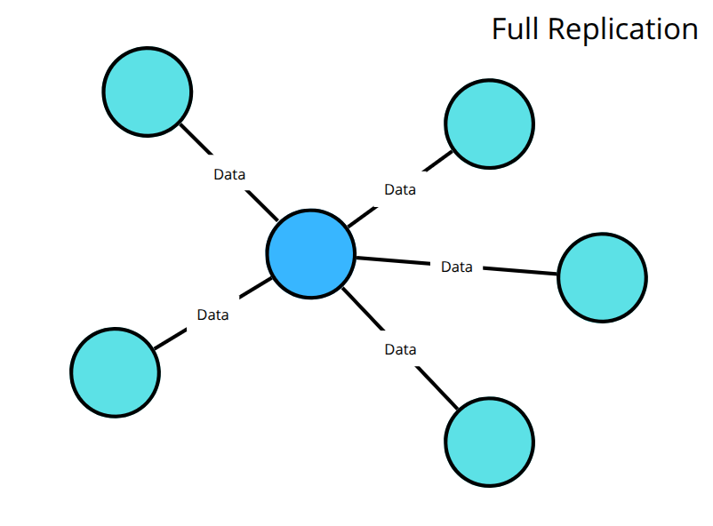
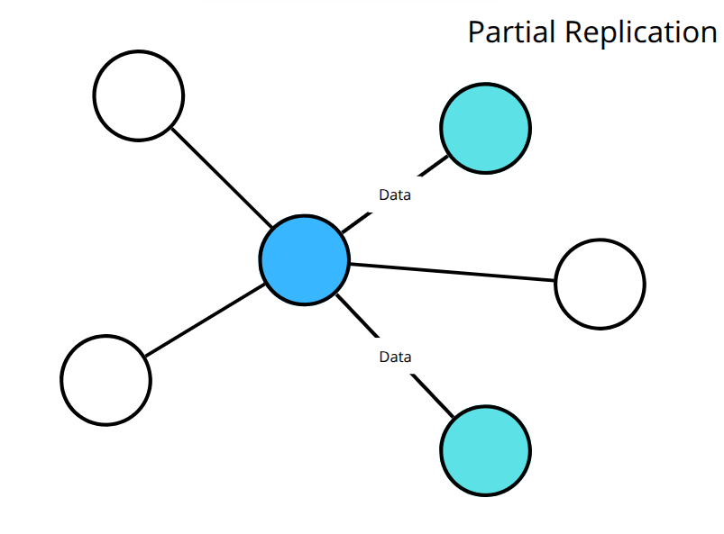
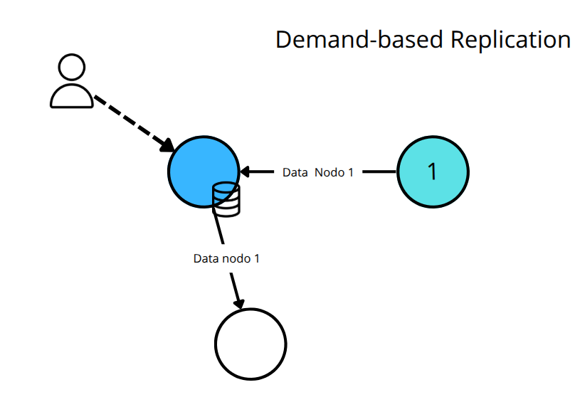
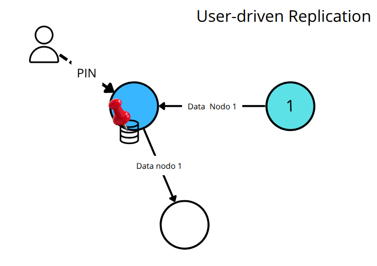
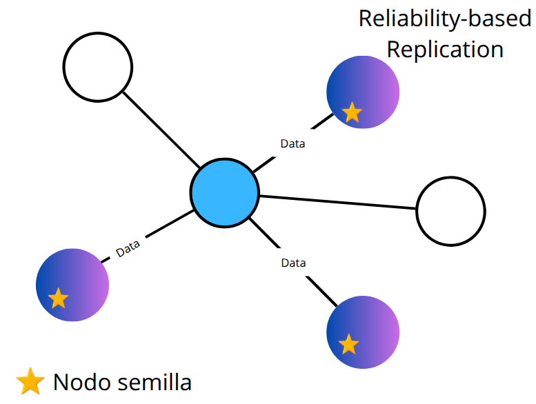
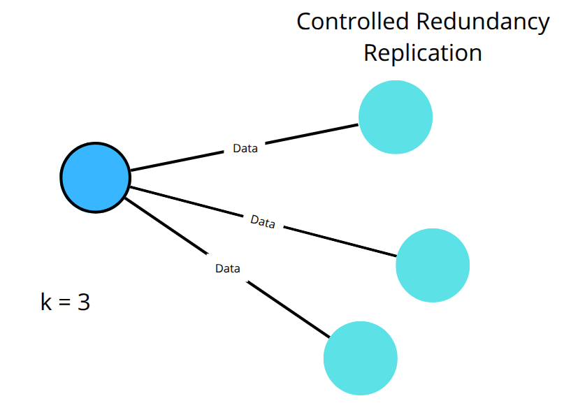
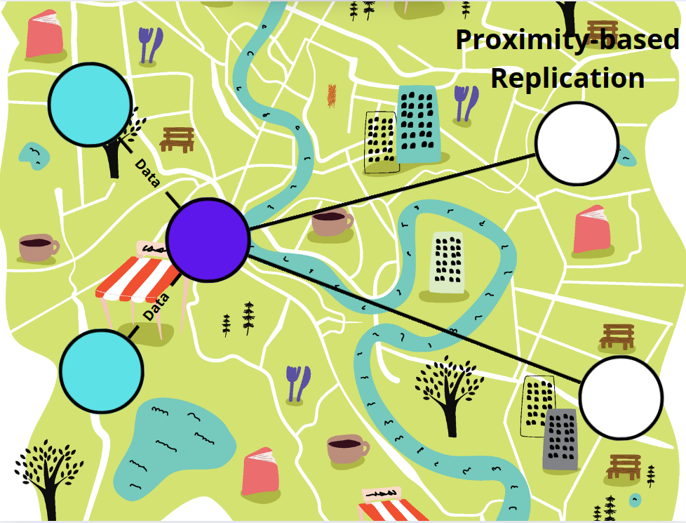

# Mecanismos de las redes p2p: replicación y consistencia

## Técnicas de replicación

En una red p2p, hemos visto que se consideran una serie de características según su propósito de la red y entre ellas está la [estrategia de almacenamiento](01-characteristics.md#estrategias-de-almacenamiento-en-redes-p2p), siendo la principal un almacenamiento distribuido, que permite mejorar la disponibilidad, balanceo de carga y resiliencia, donde se puede aplicar algunas estrategias, algo centralizadas como servidores de índices o fragmentación (sharding).

Vemos que el almacenamiento distribuido se ve condicionado por dos topológicas de redes principales, las estructuradas, basado en DHT y las no estructuradas, donde ante una operación en las estructuradas se trabaja con enrutamiento y en las no estructuradas con la replicación, que es una técnica de difusión.

Para ambos tipos de redes, estructuradas o no, cuando existe un operación de escritura (W), se usan técnicas para replicar el contenido, para que los datos estén disponibles y mejorar ante fallos, problemas de seguridad y rendimiento.

Podemos resumirlos como los siguientes técnicas:

- Replicación Total (Full Replication), ocurre cuando cada nodo de la red almacena una copia completa de todos los datos. Muy seguro pero costoso en almacenamiento y ancho de banda. Aplica principalmente en redes no estructuradas o en arquitecturas que requieren alta disponibilidad local del historial completo.

  

- Replicación Parcial (Partial Replication), cada nodo almacena solo una parte de los datos. Permite escalar reduciendo la carga en los nodos individuales. Es el modelo por defecto en redes estructuradas y también aplicable en redes no estructuradas más eficientes.

  

- Replicación Basada en Demanda (Demand-based Replication), los datos se replican automáticamente en los nodos que los solicitan, creando copias temporales o persistentes mediante mecanismos de caching, para que se puedan recupera para futuras solicitudes.

  

- Replicación Dirigida por el Usuario (User-driven Replication), el usuario selecciona explícitamente qué datos mantener replicados de forma persistente, independientemente de si han sido solicitados o no. Ejemplo: el pinning manual en IPFS, donde se fija contenido en un nodo incluso si no se ha accedido previamente.

  

- Replicación Basada en Fiabilidad (Reliability-based Replication), los datos se replican preferentemente en nodos más confiables y disponibles. Optimiza disponibilidad según la reputación, el rendimiento o contratos incentivados. Aplica típicamente en redes estructuradas con capas adicionales de selección de nodos. Ejemplos: Filecoin, [Storj](https://www.storj.io/).

  

- Replicación Basada en Redundancia Controlada (Controlled Redundancy Replication), se establece un número fijo o mínimo de copias para cada dato para garantizar disponibilidad. Común en redes estructuradas que utilizan parámetros como el factor k para redundancia. Ejemplos: Filecoin (usa acuerdos de almacenamiento —deals— que especifican cuántas copias deben mantenerse del dato), Kademlia (mantiene cada valor replicado en los k nodos más cercanos al hash de la clave para asegurar redundancia y disponibilidad).

  

- Replicación Basado en Proximidad (Proximity-based Replication), los datos se almacenan preferentemente en nodos cercanos geográficamente o en red para mejorar el acceso. Ejemplo: redes de distribución de contenido p2p, tipo [CDN](https://es.wikipedia.org/wiki/Red_de_distribuci%C3%B3n_de_contenidos).

  

> Estas técnicas no son excluyentes, una red puede aplicar varias, a no ser que sea excluyentes y pueden existir variantes. Por ejemplo, una red podría tener replicación parcial basado en proximidad y dirigido por el usuario.

## Modelos de consistencia

Establece el grado de consistencia con el que los datos replicados en los distintos nodos permanecen sincronizados tras una operación de escritura (W), determinando cuándo y cómo se consideran confirmados para garantizar que una lectura posterior (R) devuelva información coherente y actualizada.

Existen normalmente los siguientes modelos que una red p2p puede usar:

- Consistencia fuerte (Strong consistency), implica que después de una escritura, todas las lecturas en cualquier nodo reflejan el valor más reciente, por lo tanto, se espera confirmación de los nodos relevantes (como nodos validadores) antes de finalizar la escritura

  https://github.com/user-attachments/assets/1625d492-da22-487a-bed9-14b7df863b67

  > En este ejemplo, un dato escrito (W) por el nodo emisor que es cliente, debe ser replicado y luego confirmado por el conjunto de nodos relevantes, como serían los nodos validadores, en este ejemplo solo habría un nodo validador, de color azul.

- Consistencia eventual (Eventual consistency), los nodos se sincronizan con el tiempo, sin garantizar cuándo y no se espera una confirmación de escritura.

  https://github.com/user-attachments/assets/d470620e-c290-45c5-81ab-ffd6d2f70541

  > En consistencia eventual, no espera confirmación.

- Consistencia de lectura tras escritura (Read-your-writes consistency), es como en consistencia eventual, pero se garantiza que el nodo cliente que escribió el dato, si lo consulta posteriormente lo tendrá disponible. No implica que el cliente siempre vea su dato si otro nodo lo sobrescribió después.
  
  https://github.com/user-attachments/assets/b88b2dd3-32d7-477e-a631-db3d55d56371

  > En este ejemplo, el nodo emisor pregunta de forma posterior y se asegura la respuesta correcta gracias a que guardó una caché. No significa que consistencia eventual no lo haga, simplemente aquí se asegura.

- Consistencia causal (Causal consistency), garantiza que los eventos relacionados por causa-efecto se vean en el mismo orden por todos los nodos. Es decir, si un evento A influye en B, todos los nodos deben ver A antes que B.

  https://github.com/user-attachments/assets/ccc6366f-09fe-4088-a623-bc9b2b58a2a2

  > Se logra controlando el orden de entrega, en el ejemplo, se entrega C cuando llega porque no tiene una causa y efecto, sin embargo, sólo entrega B si entrego antes A.

- Consistencia secuencial (Sequential consistency), asegura que todas las operaciones se vean en el mismo orden global, aunque ese orden no sea necesariamente el real (cronológico). En causal, solo se respeta el orden entre operaciones que tienen dependencia (causa-efecto), pero en secuencial, todas las operaciones (incluso no relacionadas) deben verse en el mismo orden global por todos los nodos.

  https://github.com/user-attachments/assets/a21b72f0-36c0-457e-9010-6bb3670daebc

  > Se logra controlando el orden de entrega, en el ejemplo, como el orden es A, B y C, así debe hacerlo el nodo que debe replicar la escritura, incluso aunque en un momento dado podría haber entregado C antes que B.

**Aclaraciones**:

- En la práctica, las redes P2P rara vez implementan consistencia fuerte debido a sus problemas en rendimiento y disponibilidad, por lo tanto, suelen preferir consistencia eventual.
- Una red p2p puede seguir varios modelos, si no son contradictorios, por ejemplo, ser causal y eventual, etc.
