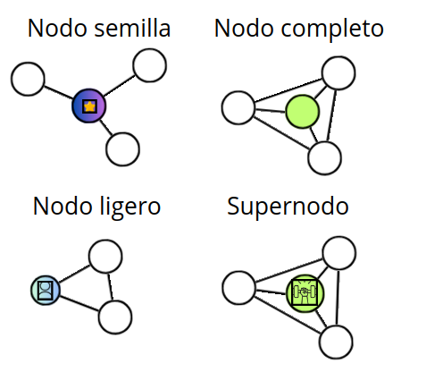
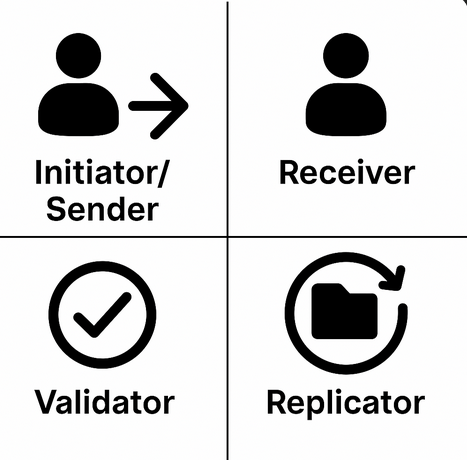
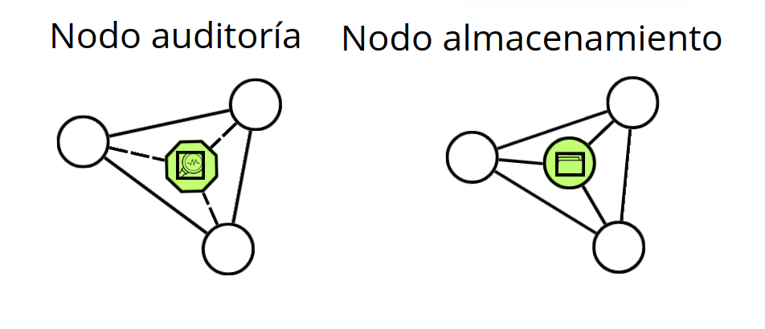
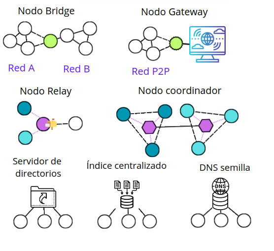

# Clasificación y roles de los nodos

Vemos que un nodo que participa en una red P2P debe soportar aspectos de la red como una [estrategia de almacenamiento](01-characteristics.md#estrategias-de-almacenamiento-en-redes-p2p), un [modelo de confianza](01-characteristics.md#modelo-de-confianza), un [modelo de autorización](01-characteristics.md#modelo-de-autorización), o cierto nivel de centralización según el [grado de descentralización](01-characteristics.md#grado-de-descentralización). Por eso, es normal que existan nodos especializados de una clase y sobre todo que asuman roles concretos según el contexto.

No es común hablar de “clasificar” un nodo en redes P2P con protocolos heterogéneos entre iguales. En estos casos, los nodos suelen asumir roles específicos dependiendo del contexto, incluso si su participación se centra principalmente en una función concreta dentro de la red.

Que un nodo ejerza un rol ayuda a distribuir tareas, optimizar recursos y mejorar la eficiencia del sistema.

Estos roles pueden ser dinámicos (un nodo puede cambiar de rol según las necesidades de la red) o fijos (asignados de forma permanente o por configuración).

Un mismo nodo puede desempeñar varios roles simultáneamente, dependiendo de su capacidad, permisos y configuración. La asignación de roles puede estar determinada por el protocolo, la reputación del nodo, incentivos económicos o la propia elección del usuario.

A continuación, se presentan las clasificaciones y roles que un nodo puede asumir normalmente en una red P2P:

## Clasificación por capacidad

Un nodo puede clasificarse según su capacidad y presencia en la red e incluso ejerciendo funciones que otro nodo de la red no tiene, afectando al grado de descentralización.

> Es casi la única clasificación que se puede encontrar a un nodo en una red p2p.

A continuación, listamos estos tipos de nodos como:

- Nodo semilla o bootstrap (como ya vimos...), nodo con una dirección conocida y accesible, usado por nodos nuevos para descubrir y conectarse inicialmente a la red. No desempeña un rol funcional continuo, pero es esencial para el arranque de la red.
- Nodo ligero (Light client), no almacena todos los datos (lo que se conoce como el estado) o el historial completo. Depende de nodos completos para verificar información mediante pruebas (ej. Merkle proofs).
  > En algunas redes modernas (ej. Mina Protocol), los light clients pueden verificar sin full nodes gracias a [zk-proofs](https://es.wikipedia.org/wiki/Prueba_de_conocimiento_cero). 🎓 Los zk-proofs requieren un estudio aparte en este repositorio, por lo tanto, no profundizaremos mucho más que este comentario.
- Nodo completo (Full node), mantiene el estado completo y todo el historial reciente o, en algunos casos, solo una parte relevante del historial si opera en modo "pruned node" (nodo podado). Puede validar, ejecutar, propagar transacciones y bloques, y servir datos a otros nodos. Está capacitado para ejercer cualquier rol funcional dentro de la red.
- Supernodo (Supernode), es un nodo completo que, además de las funciones básicas, asume tareas adicionales como coordinación, enrutamiento o gestión de recursos. Los supernodos suelen tener mayor capacidad (ancho de banda, almacenamiento, disponibilidad) y pueden actuar como intermediarios o facilitadores para otros nodos menos capaces. Su uso introduce cierto grado de centralización parcial, aunque siguen formando parte de la red P2P.
  > Supernodo se utiliza en varias redes P2P, aunque no es obligatorio en todas. Su presencia depende del diseño y necesidades de la red.

## Roles operativos

Son las diferentes tipos de operaciones que pueden asumir los nodos durante la ejecución del protocolo. Puede ser:

- Nodo emisor (Initiator/Sender), inicia solicitudes o transacciones, como la publicación de datos, envío de mensajes o peticiones de recursos. También puede denominarse nodo propietario del dato, especialmente cuando es quien origina o mantiene el recurso en la red.
- Nodo receptor (Receiver), recibe y procesa solicitudes o datos enviados por otros nodos.
- Nodo validador (Validator), verifica la validez de transacciones, bloques o datos antes de aceptarlos y propagarlos. Es fundamental en redes blockchain y sistemas que requieren consenso.
- Nodo replicador (Replicator), se encarga de almacenar y replicar datos para asegurar la disponibilidad y redundancia en la red.

## Roles funcionales

Definen las funciones que los nodos asumen en la red según las necesidades operativas:

- Nodo de monitorización/auditoría (monitoring/auditing node), recopila métricas, verifica el estado de la red o audita transacciones para propósitos de análisis, seguridad o cumplimiento.
- Nodo de almacenamiento dedicado (Dedicated storage node), especializado en almacenar grandes volúmenes de datos o archivos.

> Dependerá siempre de la red p2p, existiendo, claro esta, muchos más...

## Roles de infraestructura

Son aquellos nodos o incluso servidores que facilitan el funcionamiento básico y la conectividad de la red. Estos nodos cumplen funciones como conectar partes de la red, facilitar la comunicación entre nodos, o servir de enlace con otras redes o sistemas externos. Aunque no siempre están presentes en todas las redes P2P, su existencia puede ser clave para mejorar la accesibilidad, la interoperabilidad y la robustez de la red.

- Nodo puente (bridge), permite la comunicación entre diferentes redes P2P, facilitando el intercambio de datos o mensajes entre ellas.
- Nodo gateway o pasarela, conecta la red P2P con sistemas externos, como APIs, clientes ligeros o redes tradicionales, permitiendo la interoperabilidad y el acceso desde fuera de la red.
- Nodo coordinador, coordina y gestiona la comunicación, sincronización o reparto de tareas entre diferentes nodos o subredes. Por ejemplo, en un sistema de sharding, el nodo coordinador se encarga de asignar nodos a cada shard, coordinar la comunicación entre shards y asegurar la consistencia global de la red.
- Nodo relay, intermedia la transmisión de mensajes o datos entre nodos que no pueden establecer conexión directa, por ejemplo, cuando alguno está detrás de un NAT o firewall, o también puede actuar como relay entre subredes o shards para facilitar la comunicación y sincronización entre ellas.
- Servidor de directorios o índices centralizados, ofrece un punto de descubrimiento o consulta para que los nodos encuentren recursos, pares o contenidos dentro de la red. Aunque introduce centralización, mejora la eficiencia inicial del acceso.
- Servidor DNS semilla (seed DNS), proporciona una lista inicial de nodos conocidos (habitualmente nodos completos o bootstrap) para facilitar la incorporación de nuevos participantes. Suelen ser usados en redes como Bitcoin al inicio de la conexión.

## Nodos RPC en redes blockchain

En redes blockchain P2P, los **nodos RPC** (Remote Procedure Call) son nodos que exponen endpoints mediante el protocolo JSON-RPC, permitiendo que aplicaciones externas (dApps, wallets, exploradores de bloques) interactúen con la red sin necesidad de ejecutar un nodo completo localmente.

**Funcionamiento:**

Un nodo RPC actúa como **gateway** entre clientes externos y la red blockchain. Recibe peticiones mediante JSON-RPC sobre HTTP/WebSocket, procesa las solicitudes consultando el estado de la blockchain, y devuelve respuestas estructuradas. Las operaciones típicas incluyen:

- Consultar saldo de cuentas (`eth_getBalance`)
- Enviar transacciones firmadas (`eth_sendRawTransaction`)
- Leer datos de contratos inteligentes (`eth_call`)
- Obtener información de bloques (`eth_getBlockByNumber`)
- Suscribirse a eventos en tiempo real (mediante WebSocket)

**Tipos de nodos RPC:**

- **Nodo RPC completo (Full RPC node)**: Ejecuta un nodo completo de la blockchain, mantiene el estado actual y puede validar transacciones. Ofrece funcionalidad completa pero requiere sincronización constante.
- **Nodo RPC archive (Archive node)**: Almacena todo el historial de estados de la blockchain desde el génesis, permitiendo consultas históricas. Requiere enormes recursos de almacenamiento (varios TB en Ethereum).
- **Nodo RPC ligero**: Actúa como proxy hacia nodos completos, ofreciendo endpoints RPC sin almacenar toda la blockchain.

**Proveedores de servicios RPC:**

Ejecutar un nodo RPC propio requiere infraestructura significativa (hardware, ancho de banda, mantenimiento). Por ello, existen **proveedores de nodos RPC como servicio**, que ofrecen endpoints públicos o privados:

- **Públicos gratuitos**: Endpoints abiertos con limitaciones de tasa (rate limits), disponibilidad no garantizada, compartidos entre muchos usuarios. Ejemplos: endpoints públicos de Ethereum Foundation, Polygon, BSC.
- **Privados de pago**: Servicios como [Infura](https://www.infura.io/), [Alchemy](https://www.alchemy.com/), [QuickNode](https://www.quicknode.com/), [Ankr](https://www.ankr.com/) ofrecen endpoints dedicados con:
  - Mayor disponibilidad y SLA garantizado
  - Rate limits más altos
  - Soporte para múltiples redes blockchain
  - Funcionalidades adicionales (APIs mejoradas, webhooks, análisis)
  - Seguridad (autenticación, endpoints privados)

**Ventajas de usar servicios RPC:**

- **Reducción de costos**: Evita inversión en hardware y mantenimiento de nodos propios
- **Simplicidad**: Integración rápida mediante endpoints HTTP
- **Escalabilidad**: Infraestructura gestionada que escala automáticamente
- **Multi-cadena**: Acceso a múltiples blockchains desde un único proveedor

**Desventajas y riesgos:**

- **Centralización**: Dependencia de proveedores centralizados (punto único de fallo)
- **Privacidad**: El proveedor puede rastrear direcciones y patrones de uso
- **Confianza**: Hay que confiar en que el proveedor devuelve datos correctos (aunque se pueden verificar mediante pruebas criptográficas)
- **Disponibilidad**: Riesgo de caídas del servicio o cambios en términos de uso
- **Censura**: Proveedores pueden bloquear ciertas transacciones o direcciones

**Alternativas descentralizadas:**

Para mitigar la centralización, surgen soluciones descentralizadas de nodos RPC:

- **The Graph**: Indexación descentralizada de datos blockchain mediante subgrafos
- **Pocket Network**: Red P2P de nodos RPC donde múltiples operadores proporcionan endpoints
- **Chainstack**: Infraestructura distribuida de nodos gestionados

> 💡 Para dApps críticas o que valoran la descentralización, se recomienda usar múltiples proveedores RPC o combinación de servicios centralizados con nodos propios para redundancia.
