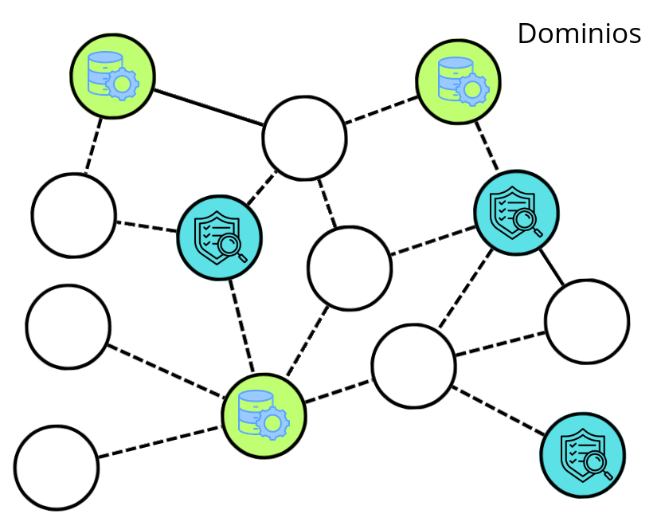
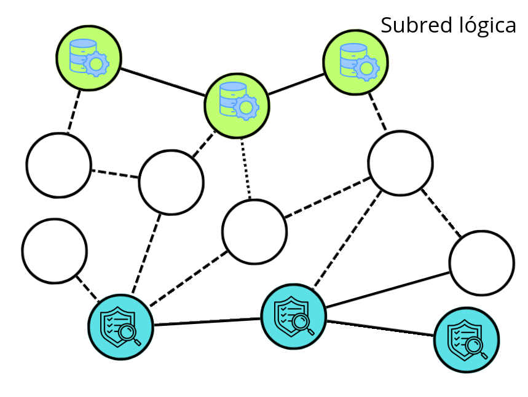
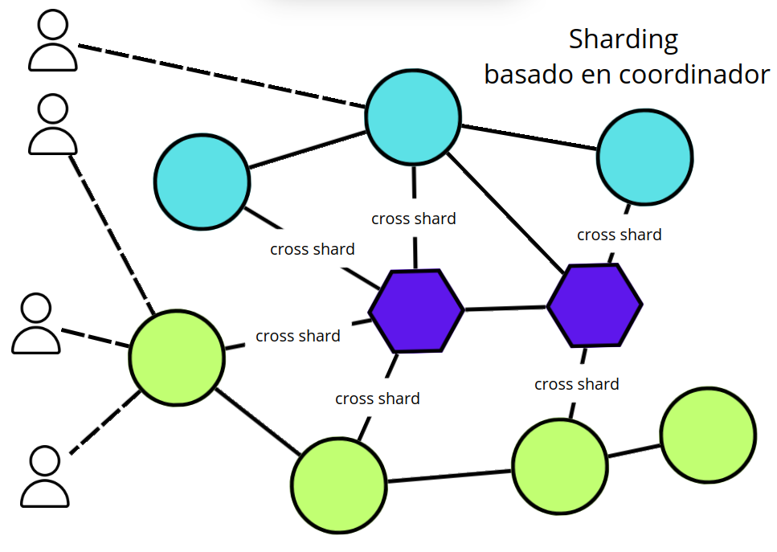
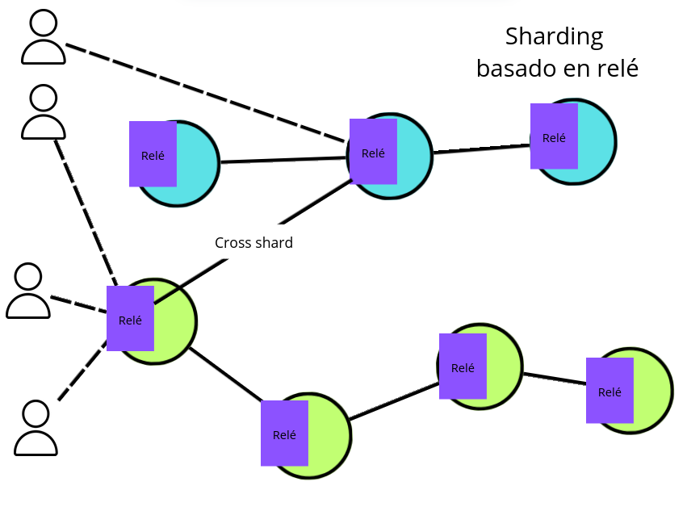

# Dominios funcionales y subredes lógicas

## Dominios funcionales

Un dominio funcional en una red P2P, es una agrupación lógica de nodos que colaboran para desempeñar una función específica dentro de la red, como enrutamiento, indexación, etc **integrado dentro de la misma red**.

  > Por ejemplo en este nodo hay dominios de almacenamiento y auditoria integrados en la red.

Estos dominios pueden estar compuestos por nodos de distintas clases, ya sea según su [capacidad](08-node-roles.md#clasificación-por-capacidad), o más comúnmente, según su rol de [infraestructura](08-node-roles.md#roles-de-infraestructura), [funcional](08-node-roles.md#roles-funcionales) u [operativo](08-node-roles.md#roles-operativos). En menor medida, también pueden estar compuesto por nodos de diferente [nivel de autorización](01-characteristics.md#modelo-de-autorización) o [confianza](01-characteristics.md#modelo-de-confianza).

> Incluso cuando existe un conjunto de nodos semilla —que en principio no ejercen un rol funcional específico—, al integrarse en un dominio funcional su función principal es proporcionar disponibilidad y facilitar el acceso inicial al resto de la red P2P.

**Ejemplos de dominios funcionales**.

- Dominio de almacenamiento, un grupo de nodos que colaboran para almacenar y replicar archivos, independientemente de su nivel de autorización. Por ejemplo, en IPFS, cualquier nodo puede unirse al dominio de almacenamiento si cumple con los requisitos de espacio y disponibilidad.
- Dominio de auditoría, nodos de diferentes clases (algunos con autorización elevados, otros públicos) que cooperan para verificar la integridad de los datos o transacciones. En una red blockchain, pueden existir nodos auditores que revisan bloques, aunque no todos tengan el mismo nivel de confianza.
- Dominio de indexación, nodos ligeros y completos que mantienen índices distribuidos para facilitar búsquedas rápidas, sin importar su rol principal en la red.
- Dominio de validación, nodos validadores y supernodos que participan en la validación de transacciones, donde algunos pueden tener permisos especiales y otros actuar como observadores.
- Dominio de monitoreo, nodos de diferentes niveles de confianza que recopilan métricas y supervisan el estado de la red, pudiendo incluir tanto nodos internos como externos.

Estos nodos pueden cooperar activamente entre sí y establecer una topología funcional propia y dinámica, optimizada para la función que desempeñan, **pero** sin dejar de estar integrados en la topología general de la red.

Su pertenencia puede ser temporal o permanente, dependiendo de la función que se requiera en cada momento.

Un mismo nodo puede pertenecer a varios dominios funcionales simultáneamente si cumple con los requisitos de cada función.

La especialización de nodos en funciones específicas puede mejorar la eficiencia de la red, pero también puede disminuir el [grado de descentralización](01-characteristics.md#grado-de-descentralización) si un número reducido de nodos concentra dichas funciones en detrimento de la participación equitativa del resto.

## Subredes lógicas en redes p2p

Las subredes lógicas, son agrupaciones de nodos dentro de una red P2P que colaboran para cumplir una **función específica** de forma independiente a la red principal.

> A diferencia de los [dominios funcionales](#dominios-funcionales) donde los nodos cooperan en la misma red, las subredes implican una separación topológica y una segmentación de la red.

Estas subredes, cono en los dominios funcionales, pueden estar compuestos por nodos de distintas clases, ya sea según su [capacidad](08-node-roles.md#clasificación-por-capacidad), o más comúnmente, según su rol de [infraestructura](08-node-roles.md#roles-de-infraestructura), [funcional](08-node-roles.md#roles-funcionales) u [operativo](08-node-roles.md#roles-operativos). En menor medida, también pueden estar compuesto por nodos de diferente [nivel de autorización](01-characteristics.md#modelo-de-autorización) o [confianza](01-characteristics.md#modelo-de-confianza).

Las subredes lógicas pueden operar bajo el mismo protocolo principal de la red, lo cual es lo más habitual, pero también pueden implementar subprotocolos específicos para adaptarse a necesidades concretas de la subred. Por ejemplo, en algunas blockchains, ciertos shards o subredes pueden utilizar un protocolo de consenso diferente al de la red principal para optimizar el rendimiento o la seguridad en función de los requisitos de cada fragmento.

**Ejemplos de subredes lógicas**.

- Redes híbridas (público-privadas), redes con [modelo de gobernanza](01-characteristics.md#modelo-de-gobernanza) consorcios o entornos empresariales, donde se requiere restringir el acceso a determinados recursos, operaciones o datos. Por ejemplo, una red blockchain puede tener una subred pública abierta a cualquier participante y otra subred privada donde solo entidades autorizadas pueden validar transacciones o acceder a información confidencial.
- Subredes de validadores autorizados en blockchains permisionadas.
- Grupos privados de almacenamiento o intercambio de datos dentro de una red P2P pública.

Estas subredes permiten especializar a nodos en funciones  mejorando la eficiencia. Sin embargo, pueden reducir el [grado de descentralización](01-characteristics.md#grado-de-descentralización), ya que ciertos nodos o grupos asumen más responsabilidad o visibilidad. Por tanto, su uso implica un equilibrio entre rendimiento, seguridad y descentralización.

### Subredes para la escalabilidad: Sharding

Estas subredes permiten **paralelizar** procesos, lo que mejora significativamente la escalabilidad; a este enfoque se le conoce como Sharding (fragmentación).

> 🎓 Generalmente, cuando en redes p2p se habla de redes adicionales a la principal, suele hacerse referencia al sharding, cuyo objetivo principal es mejorar la escalabilidad mediante la paralización de procesos. No es común utilizar el término "subredes lógicas"; este se emplea más bien para describir agrupaciones de nodos que, aunque forman parte de la misma red, cumplen funciones específicas o tienen restricciones de acceso, como en el caso de una red público-privada. La diferencia clave es que el sharding fragmenta la red para distribuir la carga de trabajo, mientras que las subredes lógicas segmentan la red según criterios funcionales o de acceso.

Es una técnica que divide la red en fragmentos (shards), cada uno de ellos responsable de procesar y almacenar subconjuntos de datos y transacciones en paralelo, fragmentando el estado de la red.

Mejora la escalabilidad en redes P2P al distribuir la carga, ya sea geográficamente, por tipo de operación solicitada o función concreta que se asigna a un conjunto de nodos.

> No es correcto considerar los shards como una red superpuesta (overlay network); en este contexto, los shards funcionan como subredes independientes, aunque relacionadas entre sí y con la red principal. No suponen una superposición lógica sobre la red principal, sino una fragmentación o partición de la misma para distribuir la carga y mejorar la escalabilidad.

Existen dos enfoques: el modelo estático, con asignación fija de nodos y datos, más simple pero menos adaptable; y el modelo dinámico, que redistribuye recursos según la demanda, ofreciendo mayor flexibilidad a costa de complejidad.

Esta fragmentación requiere mecanismos de coordinación entre fragmentos (cross-shard communication), existiendo dos modelos principales:

**Basado en conjunto de nodos coordinadores**.

Un conjunto de nodos gestionan la asignación y sincronización de los shards, actuando como punto de referencia para la comunicación y el reparto de datos entre fragmentos en la red p2p:

- Su función principal es ayudar a los nodos a descubrir y establecer relaciones con otros nodos dentro de su propio shard (en muchos casos actúan también como nodos semilla). Además permite la comunicación entre los diferentes fragmentos (shards) de la red, coordinando la comunicación cross-shard
  > Estos nodos coordinadores no validan, procesan o gestionan el tráfico interno de cada shard ni almacenan datos de usuario; su responsabilidad se limita a la coordinación y el enrutamiento de mensajes entre shards, especialmente para operaciones que requieren sincronización global o transferencia de datos entre fragmentos.

  > La comunicación entre shards es esencial para mantener la coherencia y la funcionalidad global de la red. Los nodos coordinadores gestionan esta comunicación, asegurando que los datos y las transacciones se transfieran correctamente entre los diferentes fragmentos, y evitando así la fragmentación del estado o la pérdida de información.
- Si un nodo intenta comunicarse con un nodo de un shard incorrecto, el nodo coordinador ayuda a redirigir la solicitud al shard adecuado o el nodo simplemente devolverá un error, dependiendo de la lógica implementada por la red.

**Basado en relé (relay)**.

Los propios nodos disponen un módulo relay que permite coordinar el sharding, a diferencia de tener un conjunto de nodos coordinadores.

- Cada nodo está asignado a un shard de forma determinista según reglas establecidas en el protocolo; no se requiere coordinación externa.
- El módulo relay integrado en cada nodo gestiona la comunicación cross-shard, enviando y recibiendo mensajes hacia y desde el shard correspondiente.
  > Este enfoque es más descentralizado y elimina dependencias de nodos coordinadores, reduciendo complejidad. Sin embargo, puede generar cuellos de botella a nivel de nodo, ya que cada uno asume carga adicional al manejar tráfico inter-shard, existiendo más latencia.

  > Además, exige sincronización entre nodos de distintos shards y mecanismos de verificación para asegurar integridad y evitar inconsistencia.
