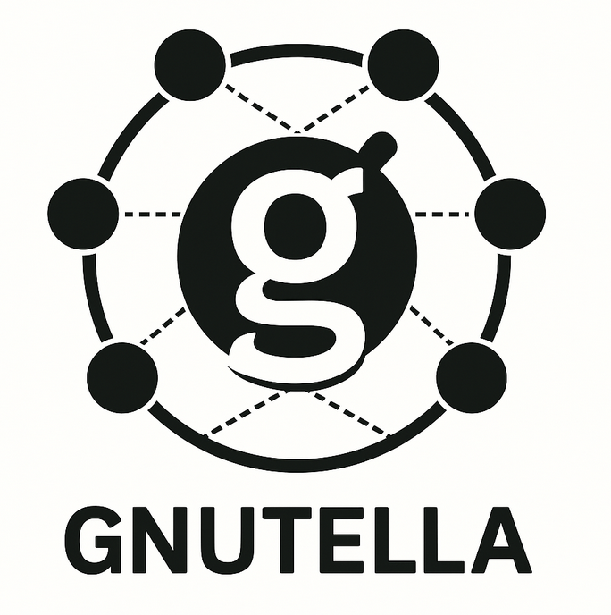
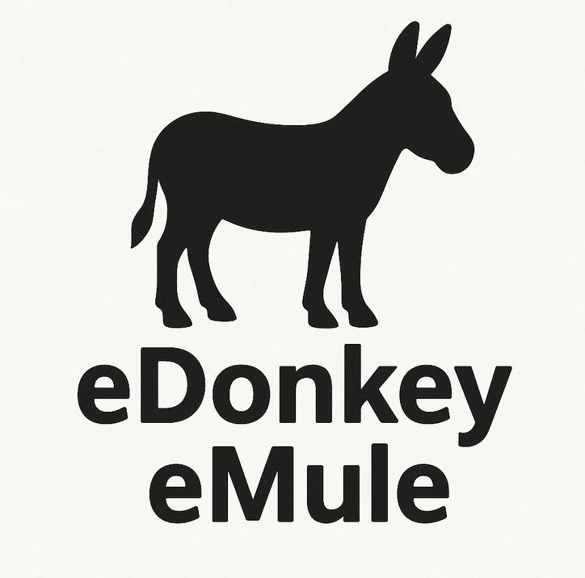
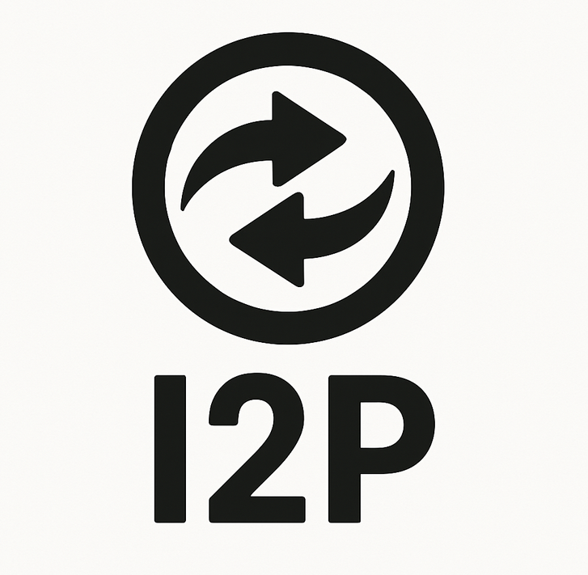
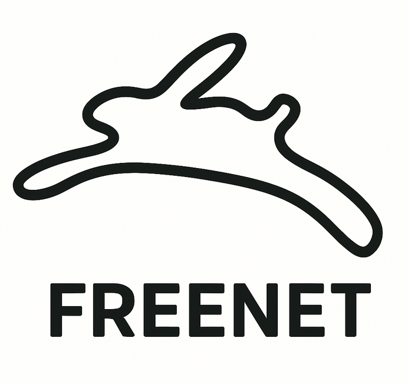
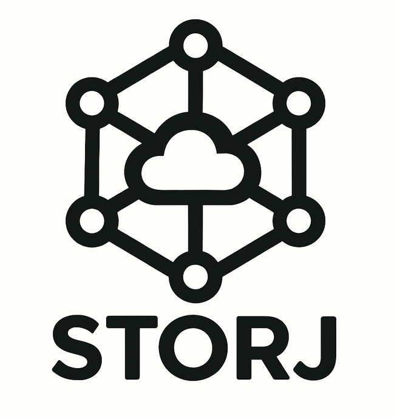
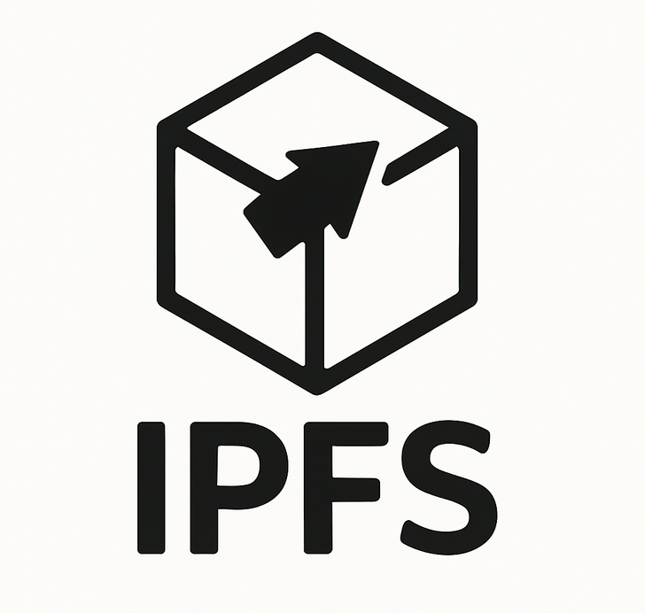
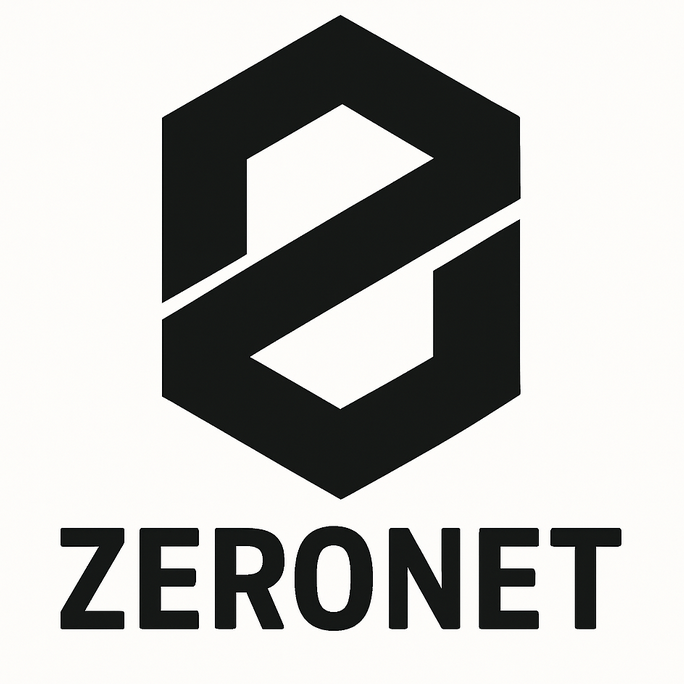
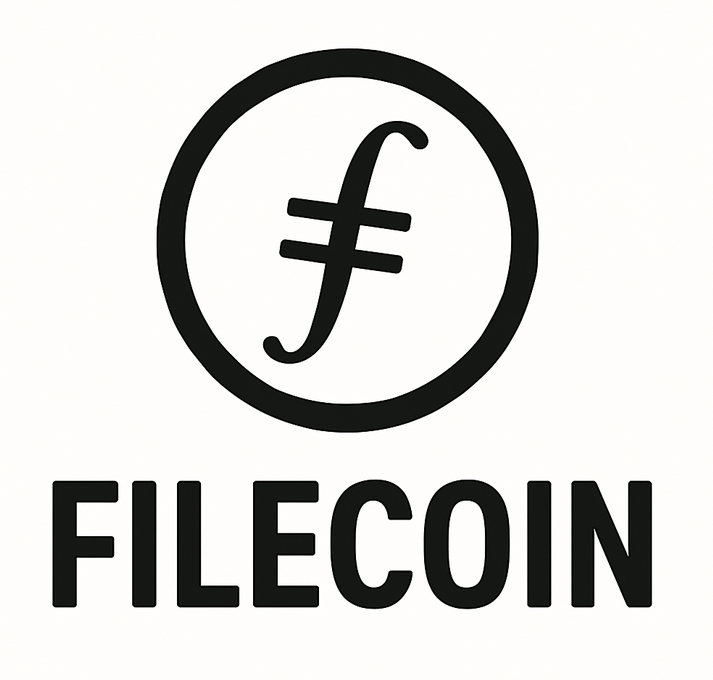

# Algunos ejemplos de redes p2p

A continuación se describen algunos ejemplos destacados de redes y nodos P2P, cada una con su propio enfoque y características técnicas:

## [Napster](https://es.wikipedia.org/wiki/Napster)

- Propósito: Compartición de archivos de música.
- [Modelo de autorización](01-characteristics.md#modelo-de-autorización): Pública, cualquier usuario podía unirse y compartir archivos sin restricciones.
- [Modelo de gobernanza](01-characteristics.md#modelo-de-gobernanza): Centralizada, gestionada por la empresa creadora de Napster, que controlaba el servidor central y las reglas del sistema.
- [Modelo de confianza](01-characteristics.md#modelo-de-confianza): Basado en confianza (trusted), los usuarios confiaban en el servidor central para indexar y localizar archivos, sin mecanismos criptográficos avanzados.
- [Tipo principal de red](03-topologies.md): Híbrida, con un servidor central para el índice y transferencia directa entre pares.
- Funcionamiento: Un servidor central mantiene un índice de los archivos disponibles, pero la transferencia de archivos ocurre directamente entre los nodos de usuarios.
- Uso de [estrategia de almacenamiento](01-characteristics.md#estrategias-de-almacenamiento-en-redes-p2p): Indexación centralizada; los archivos permanecen en los dispositivos de los usuarios, el servidor solo almacena metadatos.
- [Grado de descentralización](01-characteristics.md#grado-de-descentralización): Centralizada en el índice, descentralizada en la transferencia de archivos.
- [Replicación](07-replication-and-consistency.md#técnicas-de-replicación): Basada en demanda, según los archivos que comparten los usuarios.
- [Modelo de consistencia](07-replication-and-consistency.md#modelos-de-consistencia): Consistencia eventual; los archivos compartidos pueden variar entre nodos y no existe garantía de sincronización inmediata.

## [Gnutella](https://www.gnu.org/philosophy/gnutella.es.html)

- Propósito: Compartición de archivos de música y otros ficheros.
- [Modelo de autorización](01-characteristics.md#modelo-de-autorización): Pública, cualquier usuario puede unirse y participar sin restricciones.
- [Modelo de gobernanza](01-characteristics.md#modelo-de-gobernanza): Descentralizada, no existe una entidad central de control; las reglas están definidas por el protocolo abierto.
- [Modelo de confianza](01-characteristics.md#modelo-de-confianza): Trustless, los nodos no necesitan confiar entre sí, ya que solo intercambian archivos y metadatos directamente.
- [Tipo principal de red](03-topologies.md): No estructurada, basada en conexiones aleatorias y propagación de consultas por flooding.
- Funcionamiento: Los nodos se conectan entre sí de forma aleatoria y propagan consultas de búsqueda por flooding. Los archivos se transfieren directamente entre los nodos que los poseen.
- Uso de [estrategia de almacenamiento](01-characteristics.md#estrategias-de-almacenamiento-en-redes-p2p): Almacenamiento distribuido, cada nodo almacena los archivos que comparte localmente.
- [Grado de descentralización](01-characteristics.md#grado-de-descentralización): Inicialmente totalmente descentralizada; versiones posteriores introdujeron jerarquía parcial con nodos ultrapeer.
- [Replicación](07-replication-and-consistency.md#técnicas-de-replicación): Basada en demanda, los archivos se replican temporalmente en los nodos que los descargan.
- [Modelo de consistencia](07-replication-and-consistency.md#modelos-de-consistencia): Consistencia eventual; los archivos pueden estar disponibles en algunos nodos y no en otros, sin sincronización global.

## [eDonkey](https://es.wikipedia.org/wiki/Red_eDonkey)/[eMule](https://es.wikipedia.org/wiki/EMule)

- Propósito: Compartición de archivos de música y otros ficheros.
- [Modelo de autorización](01-characteristics.md#modelo-de-autorización): Pública, cualquier usuario puede unirse y compartir archivos sin restricciones.
- [Modelo de gobernanza](01-characteristics.md#modelo-de-gobernanza): Híbrida, con servidores centrales que gestionan índices y una red P2P para la transferencia de archivos.
- [Modelo de confianza](01-characteristics.md#modelo-de-confianza): Parcialmente confiable, los usuarios confían en los servidores para la indexación, pero la transferencia de archivos es directa entre pares.
- [Tipo principal de red](03-topologies.md): Híbrida, combina servidores centrales para búsqueda con transferencia P2P directa.
- Funcionamiento: Los archivos se dividen en partes y se distribuyen entre los usuarios. Los servidores ayudan a localizar archivos, pero la transferencia es directa entre pares.
- Uso de [estrategia de almacenamiento](01-characteristics.md#estrategias-de-almacenamiento-en-redes-p2p): Almacenamiento distribuido en los nodos, con indexación centralizada en servidores.
- [Grado de descentralización](01-characteristics.md#grado-de-descentralización): Parcialmente descentralizada, centralización en la indexación y descentralización en la transferencia.
- [Replicación](07-replication-and-consistency.md#técnicas-de-replicación): Basada en demanda, los archivos se replican en los nodos que los descargan.
- [Modelo de consistencia](07-replication-and-consistency.md#modelos-de-consistencia): Consistencia eventual; la disponibilidad de archivos depende de los nodos conectados y no hay garantía de actualización inmediata.

## [BitTorrent](https://es.wikipedia.org/wiki/BitTorrent_(programa))

- Propósito: Compartición eficiente de archivos de cualquier tipo entre usuarios.
- [Modelo de autorización](01-characteristics.md#modelo-de-autorización): Pública, cualquier usuario puede unirse y participar sin restricciones.
- [Modelo de gobernanza](01-characteristics.md#modelo-de-gobernanza): Descentralizada, el protocolo es abierto y no existe una entidad central de control.
- [Modelo de confianza](01-characteristics.md#modelo-de-confianza): Trustless, los nodos no necesitan confiar entre sí; la integridad de los archivos se verifica mediante hashes.
- [Tipo principal de red](03-topologies.md): Estructurada, utiliza un protocolo basado en DHT (Kademlia) para la localización de recursos, aunque puede apoyarse en trackers centralizados o descentralizados.
- Funcionamiento: Los archivos se dividen en partes pequeñas que se distribuyen entre los usuarios (peers). Cada usuario descarga y al mismo tiempo comparte las partes que ya tiene con otros.
- Uso de [estrategia de almacenamiento](01-characteristics.md#estrategias-de-almacenamiento-en-redes-p2p): Almacenamiento distribuido, cada nodo almacena solo las partes de los archivos que descarga y comparte.
- [Grado de descentralización](01-characteristics.md#grado-de-descentralización): Parcialmente descentralizada, ya que puede usar trackers centralizados para facilitar la localización inicial, pero la transferencia de datos es completamente P2P.
- [Replicación](07-replication-and-consistency.md#técnicas-de-replicación): Basada en demanda, las partes de los archivos se replican dinámicamente en los nodos que las descargan, aumentando la disponibilidad según la popularidad del archivo.
- [Modelo de consistencia](07-replication-and-consistency.md#modelos-de-consistencia): Consistencia eventual; las partes de los archivos pueden estar disponibles en diferentes nodos en distintos momentos.

## [Tor](https://es.wikipedia.org/wiki/Tor_(red_de_anonimato))

- Propósito: Anonimato y privacidad en la navegación y el intercambio de información.
  > Tor no es tradicionalmente considerado una red P2P en el sentido clásico (no hay compartición entre pares simétricos de recursos). Es más una red de superposición anónima.
- [Modelo de autorización](01-characteristics.md#modelo-de-autorización): Pública, cualquier usuario puede participar como cliente o relay, aunque los nodos de salida y autoridades de directorio requieren cierto nivel de confianza.
- [Modelo de gobernanza](01-characteristics.md#modelo-de-gobernanza): Federada, gestionada por la comunidad Tor y organizaciones independientes que operan las autoridades de directorio.
- [Modelo de confianza](01-characteristics.md#modelo-de-confianza): Parcialmente confiable, los usuarios confían en las autoridades de directorio y en la integridad de los relays, pero el diseño minimiza la necesidad de confianza en nodos individuales mediante cifrado en capas.
- [Tipo principal de red](03-topologies.md): Estructurada, basada en una red de relays organizados y autoridades de directorio centralizadas para la gestión de nodos.
- Funcionamiento: El tráfico se enruta por circuitos cifrados a través de múltiples nodos (relays). Las autoridades de directorio mantienen una lista firmada de nodos disponibles.
- Uso de [estrategia de almacenamiento](01-characteristics.md#estrategias-de-almacenamiento-en-redes-p2p): No almacena datos de usuario; los relays solo reenvían tráfico cifrado. Las autoridades de directorio almacenan información sobre los nodos de la red.
- [Grado de descentralización](01-characteristics.md#grado-de-descentralización): Parcialmente descentralizada; la red de relays es descentralizada, pero la gestión de directorios está centralizada en un conjunto limitado de autoridades.
- [Replicación](07-replication-and-consistency.md#técnicas-de-replicación): Replicación de la información de directorio entre múltiples autoridades para garantizar disponibilidad y tolerancia a fallos.
- [Modelo de consistencia](07-replication-and-consistency.md#modelos-de-consistencia): Consistencia fuerte para la información de directorio (sincronización entre autoridades); consistencia eventual para el estado de los relays.

## [I2P](https://geti2p.net/es/)

- Propósito: Anonimato y comunicación segura entre aplicaciones y usuarios, así como compartición de archivos y servicios internos.
- [Modelo de autorización](01-characteristics.md#modelo-de-autorización): Pública, cualquier usuario puede participar como nodo, aunque existen opciones para crear túneles privados.
- [Modelo de gobernanza](01-characteristics.md#modelo-de-gobernanza): Descentralizada, el protocolo es abierto y mantenido por la comunidad, sin una entidad central de control.
- [Modelo de confianza](01-characteristics.md#modelo-de-confianza): Parcialmente confiable, los nodos no necesitan confiar entre sí, ya que la privacidad y el anonimato se logran mediante túneles cifrados y rutas aleatorias; sin embargo, existen mecanismos de reputación para mitigar abusos.
- [Tipo principal de red](03-topologies.md): Estructurada, basada en una red de túneles y rutas virtuales, con DHT para descubrimiento y enrutamiento.
- Funcionamiento: Los nodos construyen túneles de entrada y salida independientes, enrutando mensajes a través de múltiples saltos cifrados. No existen nodos de salida global como en Tor; toda la comunicación es interna a la red I2P.
- Uso de [estrategia de almacenamiento](01-characteristics.md#estrategias-de-almacenamiento-en-redes-p2p): Almacenamiento distribuido de datos y servicios internos mediante DHT (netDb) para la localización de destinos y recursos.
- [Grado de descentralización](01-characteristics.md#grado-de-descentralización): Totalmente descentralizada, todos los nodos pueden participar en el enrutamiento y no existe jerarquía central.
- [Replicación](07-replication-and-consistency.md#técnicas-de-replicación): Replicación parcial y basada en demanda, principalmente para la información de enrutamiento y servicios publicados en la red.
- [Modelo de consistencia](07-replication-and-consistency.md#modelos-de-consistencia): Consistencia eventual; la información de enrutamiento y servicios puede variar entre nodos y se sincroniza progresivamente.

## [Freenet](https://freenet.org/)

- Propósito: Compartición anónima y resistente a la censura de archivos y publicación de contenido.
- [Modelo de autorización](01-characteristics.md#modelo-de-autorización): Pública, cualquier usuario puede participar como nodo y compartir o acceder a contenido.
- [Modelo de gobernanza](01-characteristics.md#modelo-de-gobernanza): Descentralizada, el protocolo es abierto y mantenido por la comunidad, sin entidad central de control.
- [Modelo de confianza](01-characteristics.md#modelo-de-confianza): Trustless, los nodos no necesitan confiar entre sí; la privacidad y el anonimato se logran mediante enrutamiento oscuro y cifrado.
- [Tipo principal de red](03-topologies.md): Estructurada, utiliza una DHT adaptativa y conexiones entre pares seleccionados para maximizar el anonimato.
- Funcionamiento: Los datos se fragmentan y se distribuyen automáticamente entre los nodos. El enrutamiento es adaptativo y busca maximizar el anonimato y la resiliencia.
- Uso de [estrategia de almacenamiento](01-characteristics.md#estrategias-de-almacenamiento-en-redes-p2p): Almacenamiento distribuido con replicación parcial y encriptación; los datos se almacenan en nodos aleatorios y se accede a ellos mediante claves hash.
- [Grado de descentralización](01-characteristics.md#grado-de-descentralización): Totalmente descentralizada, no existen nodos privilegiados ni jerarquía.
- [Replicación](07-replication-and-consistency.md#técnicas-de-replicación): Replicación parcial y basada en demanda; los datos se replican automáticamente en varios nodos para asegurar disponibilidad y resistencia a la censura.
- [Modelo de consistencia](07-replication-and-consistency.md#modelos-de-consistencia): Consistencia eventual; los datos pueden estar disponibles en diferentes nodos y la sincronización no es inmediata.

## [Bitcoin](https://es.wikipedia.org/wiki/Protocolo_Bitcoin)

- Propósito: Transferencia de valor digital (criptomoneda), registro inmutable de transacciones y descentralización financiera.
- [Modelo de autorización](01-characteristics.md#modelo-de-autorización): Pública, cualquier usuario puede unirse a la red, validar y propagar transacciones y bloques sin restricciones.
- [Modelo de gobernanza](01-characteristics.md#modelo-de-gobernanza): Descentralizada, las reglas del protocolo son mantenidas por la comunidad y los desarrolladores, y los cambios requieren consenso social y técnico.
- [Modelo de confianza](01-characteristics.md#modelo-de-confianza): Trustless, los nodos no necesitan confiar entre sí; la seguridad se garantiza mediante criptografía y consenso por prueba de trabajo (Proof of Work).
- [Tipo principal de red](03-topologies.md): Estructurada, basada en una red P2P de nodos completos que propagan bloques y transacciones usando técnicas de difusión (gossip).
- Funcionamiento: Los nodos validan y propagan transacciones y bloques. Cada nodo mantiene una copia de la blockchain y participa en el consenso mediante prueba de trabajo (Proof of Work).
- Uso de [estrategia de almacenamiento](01-characteristics.md#estrategias-de-almacenamiento-en-redes-p2p): Almacenamiento distribuido, cada nodo completo almacena toda la cadena de bloques; los nodos ligeros almacenan solo cabeceras y verifican mediante pruebas criptográficas.
- [Grado de descentralización](01-characteristics.md#grado-de-descentralización): Totalmente descentralizada, todos los nodos pueden participar en la validación y propagación, sin jerarquía central.
- [Replicación](07-replication-and-consistency.md#técnicas-de-replicación): Replicación total en nodos completos (full nodes), replicación parcial en nodos ligeros (light clients); la blockchain se replica íntegramente en miles de nodos para garantizar disponibilidad y resiliencia.
- [Modelo de consistencia](07-replication-and-consistency.md#modelos-de-consistencia): Consistencia eventual y secuencial; la red alcanza consistencia eventual tras la propagación y validación de bloques, y mantiene el mismo orden global de transacciones en la cadena principal.

## [Storj](https://storj.dev/)

- Propósito: Almacenamiento y compartición descentralizada de archivos en la nube, con incentivos económicos para los nodos participantes.
- [Modelo de autorización](01-characteristics.md#modelo-de-autorización): Pública y permisionada; cualquier usuario puede almacenar datos, pero los nodos de almacenamiento deben cumplir ciertos requisitos y pasar verificaciones.
- [Modelo de gobernanza](01-characteristics.md#modelo-de-gobernanza): Híbrida, Storj Labs mantiene el control operativo, aunque promueve apertura y participación de la comunidad.
- [Modelo de confianza](01-characteristics.md#modelo-de-confianza): Parcialmente confiable; la integridad y disponibilidad de los datos se garantiza mediante contratos inteligentes, reputación de nodos y pruebas criptográficas (auditorías periódicas).
- [Tipo principal de red](03-topologies.md): Estructurada, basada en nodos de almacenamiento distribuidos y coordinadores (satélites) que gestionan la asignación y auditoría de datos.
- Funcionamiento: Los archivos se fragmentan y codifican (erasure coding), luego se distribuyen entre múltiples nodos de almacenamiento. Los contratos inteligentes gestionan la relación entre clientes y nodos.
- Uso de [estrategia de almacenamiento](01-characteristics.md#estrategias-de-almacenamiento-en-redes-p2p): Almacenamiento distribuido con fragmentación y erasure coding; los fragmentos se almacenan en nodos independientes para maximizar disponibilidad y resiliencia.
- [Grado de descentralización](01-characteristics.md#grado-de-descentralización): Parcialmente descentralizada; los nodos de almacenamiento son independientes, pero los satélites actúan como coordinadores y puntos de auditoría.
- [Replicación](07-replication-and-consistency.md#técnicas-de-replicación): Replicación basada en erasure coding y redundancia controlada; se almacenan múltiples fragmentos redundantes para garantizar la recuperación ante fallos de nodos.
- [Modelo de consistencia](07-replication-and-consistency.md#modelos-de-consistencia): Consistencia eventual; los fragmentos pueden sincronizarse con retraso y la disponibilidad depende de la recuperación de fragmentos redundantes.

## [Ethereum](https://wiki.lemon.me/blockchain/ethereum-eth-que-es-y-como-funciona/)

- Propósito: Plataforma de contratos inteligentes y aplicaciones descentralizadas (dApps), además de transferencia de valor digital (Ether).
- [Modelo de autorización](01-characteristics.md#modelo-de-autorización): Pública, cualquier usuario puede unirse, validar, propagar transacciones y desplegar contratos inteligentes sin restricciones.
- [Modelo de gobernanza](01-characteristics.md#modelo-de-gobernanza): Híbrida, combina mecanismos descentralizados (comunidad, validadores, desarrolladores) y elementos centralizados (fundaciones, equipos de desarrollo principales). Las decisiones sobre actualizaciones y cambios en el protocolo se toman mediante propuestas abiertas (EIP), discusión comunitaria y consenso social/técnico.
- [Modelo de confianza](01-characteristics.md#modelo-de-confianza): Trustless, la seguridad y validez se garantizan mediante criptografía y mecanismos de consenso. Inicialmente usó prueba de trabajo (Proof of Work, hasta The Merge) y actualmente utiliza prueba de participación (Proof of Stake).
- [Tipo principal de red](03-topologies.md): Estructurada, basada en una red P2P de nodos completos que propagan bloques y transacciones usando técnicas de difusión (gossip) y mecanismos de descubrimiento de nodos (Kademlia-like).
- Funcionamiento: Los nodos almacenan el estado de la blockchain, validan y propagan transacciones y bloques, ejecutan contratos inteligentes y mantienen la sincronización mediante técnicas de difusión eficientes.
- Uso de [estrategia de almacenamiento](01-characteristics.md#estrategias-de-almacenamiento-en-redes-p2p): Almacenamiento distribuido, cada nodo completo almacena toda la cadena de bloques y el estado global; los nodos ligeros almacenan solo cabeceras y verifican mediante pruebas criptográficas.
- [Grado de descentralización](01-characteristics.md#grado-de-descentralización): Totalmente descentralizada, todos los nodos pueden participar en la validación y propagación, sin jerarquía central.
- [Replicación](07-replication-and-consistency.md#técnicas-de-replicación): Replicación total en nodos completos, replicación parcial en nodos ligeros; la blockchain y el estado se replican en miles de nodos para garantizar disponibilidad y resiliencia.
- [Modelo de consistencia](07-replication-and-consistency.md#modelos-de-consistencia): Consistencia eventual y secuencial; la red alcanza consistencia eventual tras la propagación y validación de bloques, y mantiene el mismo orden global de transacciones.

## [IPFS (InterPlanetary File System)](https://docs.ipfs.tech/concepts/what-is-ipfs/)

- Propósito: Almacenamiento y compartición descentralizada de archivos, con direccionamiento por contenido y resistencia a la censura.
- [Modelo de autorización](01-characteristics.md#modelo-de-autorización): Pública, cualquier usuario puede participar como nodo, almacenar y recuperar archivos sin restricciones.
- [Modelo de gobernanza](01-characteristics.md#modelo-de-gobernanza): Descentralizada, el protocolo es abierto y mantenido por la comunidad, aunque Protocol Labs toma un papel relevante en las decisiones, quizás también por su autoridad al respecto.
- [Modelo de confianza](01-characteristics.md#modelo-de-confianza): Trustless, la integridad y autenticidad de los datos se garantiza mediante hashes criptográficos; los nodos no necesitan confiar entre sí.
- [Tipo principal de red](03-topologies.md): Estructurada, basada en DHT (Kademlia) para descubrimiento y localización de contenido.
- Funcionamiento: Cada archivo se divide en fragmentos, se les asigna un hash único (dirección por contenido) y se distribuyen entre los nodos. La DHT permite localizar qué nodos almacenan cada fragmento.
- Uso de [estrategia de almacenamiento](01-characteristics.md#estrategias-de-almacenamiento-en-redes-p2p): Almacenamiento distribuido con replicación parcial y dirigida por el usuario (pinning); los datos se almacenan en los nodos que los solicitan o fijan.
- [Grado de descentralización](01-characteristics.md#grado-de-descentralización): Totalmente descentralizada, todos los nodos pueden almacenar, buscar y servir contenido sin jerarquía central.
- [Replicación](07-replication-and-consistency.md#técnicas-de-replicación): Replicación parcial, basada en demanda y dirigida por el usuario (pinning); los fragmentos se replican en los nodos que los solicitan o deciden mantenerlos.
- [Modelo de consistencia](07-replication-and-consistency.md#modelos-de-consistencia): Consistencia eventual y de lectura tras escritura; los datos replicados pueden estar disponibles en diferentes nodos en distintos momentos, pero el nodo que fija (pin) un contenido siempre podrá acceder a él.

## [IOTA](https://www.iota.org/)

- Propósito: Plataforma para transferencias seguras y escalables de valor y datos entre dispositivos IoT, sin comisiones y con alta eficiencia.
- [Modelo de autorización](01-characteristics.md#modelo-de-autorización): Pública, cualquier usuario o dispositivo puede participar en la red y enviar transacciones sin permisos especiales.
- [Modelo de gobernanza](01-characteristics.md#modelo-de-gobernanza): Híbrida; inicialmente con un coordinador central para proteger la red, evolucionando hacia una gobernanza descentralizada (Coordicide).
- [Modelo de confianza](01-characteristics.md#modelo-de-confianza): Trustless, la seguridad se basa en criptografía y en el consenso distribuido entre nodos, aunque el coordinador ha introducido confianza parcial en etapas previas.
- [Tipo principal de red](03-topologies.md): No estructurada, basada en gossip, aunque es una red de nodos que validan transacciones mediante el protocolo Tangle (DAG), no es una blockchain tradicional.
- Funcionamiento: Cada transacción valida dos anteriores, formando una estructura de grafo acíclico dirigido (DAG) llamada Tangle. No hay mineros ni bloques; la validación es colaborativa y escalable.
- Uso de [estrategia de almacenamiento](01-characteristics.md#estrategias-de-almacenamiento-en-redes-p2p): Almacenamiento distribuido, cada nodo almacena parte del historial de transacciones y referencias en el Tangle.
- [Grado de descentralización](01-characteristics.md#grado-de-descentralización): Parcialmente descentralizada; la red avanza hacia la total descentralización eliminando el coordinador.
- [Replicación](07-replication-and-consistency.md#técnicas-de-replicación): Replicación parcial y basada en demanda; los nodos almacenan y propagan transacciones relevantes para la validación y sincronización.
- [Modelo de consistencia](07-replication-and-consistency.md#modelos-de-consistencia): Consistencia eventual y causal; las transacciones se confirman progresivamente a medida que nuevas transacciones las referencian y validan.

## [ZeroNet](https://zeronet.io/es)

- Propósito: Publicación y compartición descentralizada de sitios web y archivos, resistente a la censura.
- [Modelo de autorización](01-characteristics.md#modelo-de-autorización): Pública, cualquier usuario puede crear, acceder y replicar sitios sin restricciones.
- [Modelo de gobernanza](01-characteristics.md#modelo-de-gobernanza): Descentralizada, el protocolo es abierto y mantenido por la comunidad, sin entidad central de control.
- [Modelo de confianza](01-characteristics.md#modelo-de-confianza): Trustless, la integridad de los contenidos se garantiza mediante firmas ECDSA y direccionamiento por clave pública.
- [Tipo principal de red](03-topologies.md): Estructurada, utiliza DHT para descubrimiento y BitTorrent para distribución de contenido.
- Funcionamiento: Cada sitio web tiene una dirección basada en clave pública. Los contenidos se distribuyen vía BitTorrent y se validan con firmas ECDSA. Cada visitante actúa como nodo replicador.
- Uso de [estrategia de almacenamiento](01-characteristics.md#estrategias-de-almacenamiento-en-redes-p2p): Almacenamiento distribuido y replicación parcial; los archivos se almacenan en los nodos que visitan o replican los sitios.
- [Grado de descentralización](01-characteristics.md#grado-de-descentralización): Totalmente descentralizada, todos los nodos pueden participar en la publicación, replicación y acceso sin jerarquía central.
- [Replicación](07-replication-and-consistency.md#técnicas-de-replicación): Replicación parcial y basada en demanda; los sitios se replican automáticamente en los nodos que los visitan, aumentando la disponibilidad y resiliencia.
- [Modelo de consistencia](07-replication-and-consistency.md#modelos-de-consistencia): Consistencia eventual y de lectura tras escritura; los sitios replicados pueden variar entre nodos, pero el creador o replicador siempre puede acceder a su copia.

## [Filecoin](https://filecoin.io/)

- Propósito: Almacenamiento y compartición descentralizada de archivos con incentivos económicos.
- [Modelo de autorización](01-characteristics.md#modelo-de-autorización): Pública y permisionada; cualquier usuario puede almacenar datos, pero los mineros de almacenamiento deben cumplir requisitos y pasar verificaciones.
- [Modelo de gobernanza](01-characteristics.md#modelo-de-gobernanza): Descentralizada, gestionada por la comunidad y Protocol Labs, con propuestas y mejoras abiertas.
- [Modelo de confianza](01-characteristics.md#modelo-de-confianza): Trustless y parcialmente confiable; la integridad y disponibilidad se garantizan mediante pruebas criptográficas (Proof of Replication, Proof of Spacetime) y reputación de los mineros.
- [Tipo principal de red](03-topologies.md): Estructurada, basada en DHT (Kademlia) para descubrimiento y localización de recursos, y subredes lógicas para coordinación.
- Funcionamiento: Los usuarios (clientes) pagan a los mineros de almacenamiento para guardar archivos. Los mineros demuestran periódicamente que almacenan los datos mediante pruebas criptográficas (Proof of Replication y Proof of Spacetime).
- Uso de [estrategia de almacenamiento](01-characteristics.md#estrategias-de-almacenamiento-en-redes-p2p): Almacenamiento distribuido con fragmentación (sharding) y erasure coding; los datos se dividen en fragmentos codificados y se distribuyen entre múltiples mineros.
- [Grado de descentralización](01-characteristics.md#grado-de-descentralización): Parcialmente descentralizada; los mineros son independientes, pero existen mecanismos de coordinación y subredes para gestión y auditoría.
- [Replicación](07-replication-and-consistency.md#técnicas-de-replicación): Basada en erasure coding y redundancia controlada; se almacenan múltiples fragmentos redundantes para garantizar recuperación y disponibilidad ante fallos de nodos.
- [Modelo de consistencia](07-replication-and-consistency.md#modelos-de-consistencia): Consistencia eventual; los fragmentos pueden sincronizarse con retraso y la disponibilidad depende de la recuperación y verificación periódica mediante pruebas criptográficas.
